# Mini RPG Python — cours et missions détaillés

Construis le même mini RPG textuel en six versions successives dans le navigateur, puis donne-lui une interface graphique sur ordinateur (partie 7). Pour chaque partie : lis le cours, prédis l’exemple, expérimente, puis écris ta solution. Reprends le code utile des parties précédentes et conserve les six versions pour montrer ta progression.

À rendre : un seul fichier NOM_Prenom_mini_rpg.py exporté depuis le navigateur. Il contient six versions du RPG sélectionnées au lancement par un menu fourni. Chacune se lance seule : reprends dans sa partie le code nécessaire des TP précédents, car leurs variables ne sont pas automatiquement disponibles. Ne modifie pas les marqueurs de partie. Dans chaque partie, suis les tests demandés et commente les résultats. Pour le TP2, écris 19 appels de test avec print et vérifie les trois scénarios de la scène ; pour les autres parties, conserve au moins deux tests commentés (entrées, attendu, observé). En tête du fichier, indique les aides utilisées et une correction que tu sais expliquer. Sauvegarde à chaque séance ; une sauvegarde du navigateur ne remplace pas le fichier téléchargé. La partie 7 (interface graphique) se fait sur ordinateur, dans un second fichier : NOM_Prenom_rpg_interface.py.

Télécharge ton fichier .py en fin de séance. Le bouton de téléchargement ouvre une fenêtre avec un lien explicite et une copie du code en secours. Le bouton Reprendre un fichier .py permet de continuer à la séance suivante.

## Partie 1 — Créer son personnage

### 1. Une variable garde une valeur

Une variable est un nom associé à une valeur. Pour créer ou modifier cette association, on utilise =. Python exécute les lignes dans l’ordre : la dernière affectation remplace la précédente.

```python
pv = 50
pv = pv - 10
print(pv)
```

**À l’écran :**

```text
40
```

À surveiller : = signifie « affecter », pas « est égal à » au sens d’un test. On calcule le côté droit avant de modifier la variable.

### 2. Texte et nombres ne se manipulent pas pareil

Une chaîne de caractères (str) se met entre guillemets. Un entier (int) s’écrit sans guillemets. + additionne des entiers ; entre deux chaînes, il colle les textes.

```python
print(5 + 5)
print("5" + "5")
```

**À l’écran :**

```text
10
55
```

À surveiller : La valeur 5 et le texte « 5 » se ressemblent à l’écran, mais n’ont pas le même type.

### 3. Lire avec input, afficher avec print

input affiche une question, puis renvoie le texte tapé. print affiche une ou plusieurs valeurs. Les virgules dans print séparent les éléments à afficher.

```python
nom = input("Ton nom ? ")
print("Bienvenue", nom)
```

**À l’écran :**

```text
Si tu saisis Lina : Bienvenue Lina
```

À surveiller : input renvoie toujours du texte. Écrire input sans les parenthèses n’appelle pas la fonction.

### 4. Convertir une saisie numérique

Pour calculer avec un nombre saisi, int transforme le texte en entier. Lis de l’intérieur vers l’extérieur : input récupère le texte, int le convertit, puis = affecte le résultat.

```python
force = int(input("Force ? "))
print(force + 2)
```

**À l’écran :**

```text
Si tu saisis 5 : 7
```

À surveiller : Pour cette séance, on suppose que l’élève tape un entier. Si on tape cinq en lettres, int provoque une erreur ; ce cas n’est pas demandé.

### 5. Choisir un chemin avec if, elif et else

== compare deux valeurs. if exécute un bloc si son test est vrai ; elif teste un autre cas ; else traite les autres possibilités. Les quatre espaces au début d’une ligne montrent le bloc auquel elle appartient.

```python
action = "dormir"
if action == "attaquer":
    print("À l’attaque !")
elif action == "soigner":
    print("Une potion !")
else:
    print("Action inconnue")
```

**À l’écran :**

```text
Action inconnue
```

À surveiller : Ne remplace pas elif action == "soigner" par else : sinon dormir déclencherait aussi un soin.

### 6. Vérifier plusieurs contraintes

and signifie que toutes les conditions reliées doivent être vraies : il suffit qu’une seule soit fausse pour que le test complet soit faux. Dans l’exemple, le total est bon mais une valeur est négative. Pour valider ton personnage, même idée : la somme doit valoir 15 ET chaque compétence doit être positive ou nulle.

```python
pieces = 12
cle = -2
total = pieces + cle
valide = total == 10 and cle >= 0
print(total)
print(valide)
```

**À l’écran :**

```text
10
False
```

À surveiller : Une somme correcte ne suffit pas : -1 + 8 + 8 vaut 15, mais une compétence négative doit être refusée. Vérifie la somme ET chacune des trois valeurs.

### Petites quêtes

#### Échauffement A · la potion timide

Le héros a 30 PV. Ajoute 12 PV puis affiche sa nouvelle vie. Écris les deux lignes manquantes.

```python
pv = 30
# TODO : augmenter les PV de 12
# TODO : afficher les PV
```

Objectif : 42

Indice : Réutilise pv = pv + ... puis print(...).

#### Échauffement B · une force bien réelle

Demande la force sous forme d’un entier, puis affiche le double. Teste avec 4 puis 7.

```python
# TODO : demander et convertir la force
# TODO : afficher son double
```

Objectif : 4 → 8 ; 7 → 14

Indice : Utilise int(input(...)) ; le double se calcule avec * 2.

### Mission

Une création de personnage en console. On ne combat pas encore dans le programme à rendre de cette partie. Conserve ce code : au TP2, tu reprendras les saisies nom, classe, force, intelligence et agilite ainsi que leurs contrôles. Ces caractéristiques serviront ensuite aux dégâts, au soin et à la réussite des attaques.

1. Dans Mon travail, écris nom = input(...) et classe = input(...). Les trois classes reconnues sont exactement guerrier, mage et archer, en minuscules.

2. Avec if / elif / else, affiche un accueil pour une classe reconnue et « Classe inconnue » sinon. Tu n’as pas à redemander la classe dans cette partie.

3. Demande force, intelligence et agilite avec int(input(...)). Les saisies sont supposées être des entiers.

4. Calcule total = force + intelligence + agilite. Affiche le nom, la classe, les trois valeurs et le total.

5. Affiche « Répartition valide » seulement si total vaut 15 ET si aucune des trois valeurs n’est négative. Sinon, affiche « Répartition invalide ». Le contrôle de la répartition est indépendant du contrôle de classe.

6. Lance les tests proposés et ajoute deux commentaires : entrées, résultat attendu, résultat observé. Télécharge ensuite ton fichier .py.

### Tests

- Lina, mage, 5, 4, 6 → total 15 et répartition valide.
- 5, 5, 6 → total 16, invalide ; -1, 8, 8 → total 15 mais invalide.
- Classe dragon → classe inconnue. Dans le bac à sable, l’exemple fourni avec la saisie dormir → « Action inconnue » et PV inchangés (50).

### Critères de réussite · repères sur 5

- Nom, classe et accueil cohérents : 1 point(s)
- Conversions et calcul du total : 1 point(s)
- Somme 15 et non-négativité vérifiées : 2 point(s)
- Deux tests commentés avec attendu et observé : 1 point(s)

## Partie 2 — Hasard, bibliothèques et premières fonctions

TP2 · séance de 2 h. Repères indicatifs : 25 min pour les notions 1 à 9 (fonctions, return, booléens), 10 min d’échauffement, 45 min pour définir et tester les fonctions en consultant les notions 10 à 19 (hasard et tests) au fil des étapes de mission, 25 min pour la scène, 15 min de vérification et de sauvegarde. Les six fonctions et leurs tests font partie du rendu. Écris toi-même chaque ligne def, ses paramètres, les deux-points et son corps. Si tout est terminé et expliqué, commence le TP3.

### 1. Une fonction : un petit programme que l’on peut appeler

Une fonction est un bloc d’instructions auquel on donne un nom pour pouvoir le réutiliser. def signifie définir : Python mémorise ce bloc, mais ne l’exécute pas encore. saluer() appelle la fonction et exécute son corps. Après l’appel, le programme continue à la ligne suivante.

```python
def saluer():
    print("Bienvenue dans la forêt")

print("Avant")
saluer()
print("Après")
```

**À l’écran :**

```text
Avant
Bienvenue dans la forêt
Après
```

À surveiller : Les deux-points terminent la ligne def. Les quatre espaces placent print dans la fonction. Ici, saluer affiche un message ; elle ne fournit pas de résultat utile à réutiliser.

### 2. Recevoir des valeurs : paramètres et arguments

Dans la définition, force et bonus sont les paramètres : des noms qui recevront des valeurs. Dans calculer_degats(8, 3), 8 et 3 sont les arguments. Pendant cet appel, force vaut 8 et bonus vaut 3. La fonction calcule 11 et le renvoie ; la variable degats reçoit ce résultat.

```python
def calculer_degats(force, bonus):
    total = force + bonus
    return total

degats = calculer_degats(8, 3)
print(degats)
```

**À l’écran :**

```text
11
```

À surveiller : On définit la fonction une fois, puis on peut l’appeler plusieurs fois. Les paramètres appartiennent à l’appel de la fonction ; utilise le résultat renvoyé pour récupérer le calcul.

### 3. Renvoyer une valeur : suivre le trajet de return

return transmet une valeur au code qui a appelé la fonction et termine immédiatement cet appel. Lis dans cet ordre : ajouter_bonus(4) reçoit 4 ; resultat devient 7 ; return renvoie 7 ; points reçoit 7 ; print affiche 7. Renvoyer ne signifie pas afficher.

```python
def ajouter_bonus(points):
    resultat = points + 3
    return resultat

points = ajouter_bonus(4)
print(points)
print(points + 1)
```

**À l’écran :**

```text
7
8
```

À surveiller : return s’écrit à l’intérieur d’une fonction. Il termine l’appel de cette fonction, pas tout le programme. Une instruction placée après un return exécuté dans le même bloc ne sera pas exécutée.

### 4. Afficher n’est pas renvoyer

print montre une valeur à l’écran, mais le programme ne peut pas la réutiliser. return transmet la valeur au code qui a appelé la fonction : on peut la stocker dans une variable, puis s’en servir dans un calcul ou un test.

```python
def bonus_affiche(force):
    print(force + 2)

def bonus_renvoie(force):
    return force + 2

bonus_affiche(5)
attaque = bonus_renvoie(5)
print(attaque + 1)
```

**À l’écran :**

```text
7
8
```

À surveiller : Le premier 7 est seulement affiché. Le second 7 est d’abord renvoyé, stocké, puis réutilisé pour calculer 8.

### 5. Un booléen : une valeur qui répond vrai ou faux

Le type bool possède deux valeurs : True (vrai) et False (faux). Un booléen répond à une question par oui ou par non : la porte est-elle ouverte ? l’attaque réussit-elle ? Écris True et False avec une majuscule et sans guillemets.

```python
porte_ouverte = True
print(porte_ouverte)
print(type(porte_ouverte))
print(type("True"))
```

**À l’écran :**

```text
True
<class 'bool'>
<class 'str'>
```

À surveiller : "True" est du texte, pas un booléen. On utilise True et False pour exprimer une réponse logique dans ce TP, plutôt que les nombres 1 et 0.

### 6. Une comparaison fabrique un booléen

Une comparaison est une expression dont le résultat vaut True ou False. > signifie strictement supérieur ; >= signifie supérieur ou égal ; == teste l’égalité. On peut stocker le résultat dans une variable avant de l’utiliser dans un if.

```python
de = 11
seuil = 11
reussite = de >= seuil
print(reussite)
print(de > seuil)
if reussite:
    print("Touché !")
```

**À l’écran :**

```text
True
False
Touché !
```

À surveiller : Le signe = stocke une valeur ; == compare deux valeurs. À la frontière 11, > et >= ne donnent pas la même réponse.

### 7. Renvoyer vrai ou faux avec if et else

Commence par la version détaillée. La fonction pose la question « le dé atteint-il le seuil ? ». Si oui, elle renvoie True. Sinon, elle renvoie False. Chaque appel ne suit qu’un seul chemin et renvoie une seule valeur. Le premier appel ci-dessous suit else ; le second suit if.

```python
def attaque_reussie(de, seuil):
    if de >= seuil:
        return True
    else:
        return False

print(attaque_reussie(10, 11))
print(attaque_reussie(11, 11))
```

**À l’écran :**

```text
False
True
```

À surveiller : if est indenté de quatre espaces dans def ; return est indenté de huit espaces dans if ou else. Renvoyer "True" serait renvoyer du texte. Sans le return False, le cas raté renverrait None, pas False.

### 8. Utiliser la réponse de la fonction

On distingue trois étapes : appeler la fonction, stocker sa réponse, puis décider quoi afficher. reussite contient un booléen. if reussite: lit « si la réponse est vraie ». Le print se trouve dans le programme qui appelle la fonction.

```python
def attaque_reussie(de, seuil):
    if de >= seuil:
        return True
    else:
        return False

reussite = attaque_reussie(12, 11)
print(reussite)
if reussite:
    print("Touché !")
else:
    print("Raté !")
```

**À l’écran :**

```text
True
Touché !
```

À surveiller : La fonction décide si l’attaque réussit ; le programme utilise cette réponse. Remplace 12 par 10 et prédis les deux affichages avant de relancer.

### 9. Pour aller plus loin : comprendre l’écriture courte

La version avec if / else est une solution complète et acceptée. Quand tu la comprends, tu peux lire return a > b : Python calcule d’abord a > b, obtient True ou False, puis renvoie cette valeur. Les parenthèses dans return (a > b) sont facultatives. Il n’est pas nécessaire d’utiliser cette écriture courte dans ton rendu.

```python
def est_superieur(a, b):
    if a > b:
        return True
    else:
        return False

def est_superieur_court(a, b):
    return a > b

print(est_superieur(5, 3))
print(est_superieur_court(5, 3))
print(est_superieur(3, 3))
print(est_superieur_court(3, 3))
```

**À l’écran :**

```text
True
True
False
False
```

À surveiller : Dans la mission, la règle est de >= seuil : le seuil lui-même réussit. Le raccourci ne change jamais la règle choisie.

### 10. Utiliser un module

Un module regroupe des fonctions. import random permet d’utiliser celles du hasard. On écrit le nom du module, un point, puis le nom de la fonction.

```python
import random
de = random.randint(1, 20)
print(de)
```

**À l’écran :**

```text
Un entier entre 1 et 20, bornes incluses.
```

À surveiller : Ne nomme pas ton fichier random.py : il risquerait de masquer le module fourni avec Python.

### 11. Comprendre les bornes du hasard

random.random() donne un nombre supérieur ou égal à 0 et strictement inférieur à 1. random.randint(a, b) donne un entier entre a et b inclus. Le hasard est produit par un algorithme : il est pseudo-aléatoire.

```python
import random
print(random.random())
print(random.randint(0, 10))
```

**À l’écran :**

```text
Par exemple 0.37 puis 8. Le résultat peut changer.
```

À surveiller : int(random.random()*10) donne 0 à 9, pas 0 à 10. Une petite série de tirages n’a pas forcément les proportions prévues.

### 12. Une fonction sans paramètre

Une fonction peut ne recevoir aucune information. Les parenthèses restent obligatoires dans la définition et dans l’appel. Ici chaque appel effectue un nouveau tirage.

```python
import random
def lancer_d6():
    return random.randint(1, 6)

print(lancer_d6())
print(lancer_d6())
```

**À l’écran :**

```text
Deux entiers de 1 à 6, souvent différents.
```

À surveiller : Écrire print(lancer_d6) affiche une représentation de la fonction. Il faut les parenthèses pour l’appeler. La notion suivante rend le nombre de faces paramétrable.

### 13. Fabriquer un dé réutilisable

Une fonction peut utiliser un paramètre dans l’appel d’une fonction de bibliothèque. lancer_de(6) et lancer_de(20) exécutent le même algorithme avec des bornes différentes.

```python
import random
def lancer_de(nb_faces):
    return random.randint(1, nb_faces)

print(lancer_de(6))
print(lancer_de(20))
```

**À l’écran :**

```text
Un entier de 1 à 6, puis un entier de 1 à 20.
```

À surveiller : La fonction renvoie le tirage. Elle ne doit pas toujours utiliser 20 à la place du paramètre nb_faces.

### 14. Tester avant de remettre le hasard

Pour vérifier une règle, commence avec des valeurs choisies. Vérifie les frontières, puis remets le tirage aléatoire. Un petit nombre de tirages n’a pas forcément les proportions théoriques.

```python
def attaque_reussie(de, seuil):
    if de >= seuil:
        return True
    else:
        return False

print(attaque_reussie(10, 11))
print(attaque_reussie(11, 11))
print(attaque_reussie(12, 11))
```

**À l’écran :**

```text
False
True
True
```

À surveiller : Un test aléatoire peut réussir par hasard malgré une erreur. Les valeurs fixes rendent le test reproductible.

### 15. Faire entrer une valeur dans une fonction

input lit toujours du texte. Convertis la saisie, puis donne la valeur obtenue comme argument de la fonction. Tu peux changer la réponse ci-dessous avant chaque exécution.

```python
import random
def lancer_de(nb_faces):
    return random.randint(1, nb_faces)

faces = int(input("Nombre de faces ? "))
resultat = lancer_de(faces)
print("Résultat :", resultat)
```

**À l’écran :**

```text
Avec 6 : un entier entre 1 et 6.
```

À surveiller : La valeur saisie doit être un entier positif. Dans cet exercice, on ne traite pas encore une saisie non numérique.

### 16. Tester une fonction avec print

Un test consiste à choisir des entrées, prévoir le résultat à partir de la consigne, exécuter le programme, puis comparer le résultat obtenu au résultat attendu. Calcule l’attendu avant de lancer le code : il ne doit pas être recopié depuis la sortie de ta fonction. Ici, on vérifie une fonction indépendante du RPG. Chaque print précise l’appel, l’attendu et l’obtenu.

```python
def prix_places(nombre, tarif):
    return nombre * tarif

# Cas ordinaire : 3 places à 4 euros coûtent 12 euros.
print("prix_places(3, 4) | attendu : 12 | obtenu :", prix_places(3, 4))
# Cas particulier : aucune place ne coûte rien.
print("prix_places(0, 4) | attendu : 0 | obtenu :", prix_places(0, 4))
```

**À l’écran :**

```text
prix_places(3, 4) | attendu : 12 | obtenu : 12
prix_places(0, 4) | attendu : 0 | obtenu : 0
```

À surveiller : Ces print ne décident pas automatiquement si le test réussit : c’est à toi de comparer. Un résultat None peut signaler un return oublié. Une erreur Python est aussi un résultat à analyser.

### 17. Choisir des cas qui peuvent révéler une erreur

Un cas ordinaire vérifie une situation courante. Un test de frontière vérifie l’endroit où la règle change : juste avant, exactement à la limite, juste après. Pour un accès autorisé à partir de 12 ans, on teste 11, 12 et 13. Le cas 12 distingue >= de >. Teste aussi chaque branche : une réponse True et une réponse False. Pour une fonction paramétrable, change le paramètre : cela révèle une valeur écrite en dur.

```python
def acces_autorise(age):
    if age >= 12:
        return True
    else:
        return False

print("11 ans | attendu : False | obtenu :", acces_autorise(11))
print("12 ans | attendu : True | obtenu :", acces_autorise(12))
print("13 ans | attendu : True | obtenu :", acces_autorise(13))
```

**À l’écran :**

```text
11 ans | attendu : False | obtenu : False
12 ans | attendu : True | obtenu : True
13 ans | attendu : True | obtenu : True
```

À surveiller : Un test a une raison d’être. Trois valeurs toutes éloignées de la limite peuvent laisser passer une erreur. Quelques tests réussis ne prouvent pas que le programme est correct pour toutes les entrées.

### 18. Tester une règle et tester le hasard

Pour une fonction déterministe, les mêmes entrées donnent le même résultat : tu peux prévoir une valeur précise. Pour un dé, tu ne peux généralement pas prévoir le nombre tiré ; tu vérifies plutôt qu’il s’agit d’un entier entre les bornes autorisées. Stocke un seul tirage et vérifie cette même valeur. Tester un dé à une face donne un cas particulier dont le résultat est certain : 1.

```python
import random

tirage = random.randint(1, 6)
print("Dé 6 faces | attendu : entier de 1 à 6 | obtenu :", tirage)
print("Type attendu : int | obtenu :", type(tirage))
print("Bornes attendues : True | obtenu :", 1 <= tirage <= 6)
```

**À l’écran :**

```text
Le nombre varie de 1 à 6.
Le type est <class 'int'>.
Le contrôle des bornes affiche True.
```

À surveiller : 1 <= tirage <= 6 signifie que tirage est au moins 1 et au plus 6. Un tirage correct ne suffit pas à valider toute une fonction aléatoire. Vérifie aussi le code, change le nombre de faces et relance. Ne demande pas au hasard de produire un résultat fixé.

### 19. Passer des tests de fonctions au test du programme

Teste d’abord chaque fonction seule, puis leur assemblage. Une fonction peut être correcte alors que le programme oublie de récupérer son résultat. Ici, le premier appel renvoie bien 12, mais stock reste 9. Le second appel affecte le résultat à stock. Pour le RPG, pense à réaffecter les PV renvoyés par les fonctions.

```python
def ajouter_stock(stock, livraison):
    return stock + livraison

stock = 9
ajouter_stock(stock, 3)
print("Sans récupération :", stock)
stock = ajouter_stock(stock, 3)
print("Avec récupération :", stock)
```

**À l’écran :**

```text
Sans récupération : 9
Avec récupération : 12
```

À surveiller : Si attendu et obtenu diffèrent, garde une trace du test, recherche l’erreur, corrige puis relance. Pour tester une scène avec un dé, remplace temporairement le hasard par une valeur choisie, puis restaure le tirage après vérification.

### Petites quêtes

#### Échauffement A · le dé miniature

Importe random et lance un dé à 6 faces. Affiche son résultat.

```python
# TODO : import
# TODO : tirer un entier entre 1 et 6
# TODO : afficher
```

Objectif : Toujours un entier de 1 à 6.

**Indice 1** — Il faut obtenir un nombre, puis l’afficher.

**Indice 2** — Importe random. randint reçoit deux bornes incluses.

**Indice 3** — Complète les bornes et la variable affichée.

```python
import random
de = random.randint(___, ___)
print(___)
```

#### Échauffement B · trois points de courage

Écris une fonction ajouter_bonus(points) qui renvoie points + 3. Ajoute toi-même sa définition au-dessus de l’appel proposé. Remplace les ... par 4 pour appeler la fonction et afficher le résultat. Les ... indiquent ici du code à compléter, pas une valeur à conserver.

```python
print(ajouter_bonus(...))
```

Objectif : 7

**Indice 1** — La fonction doit donner un résultat au programme qui l’appelle.

**Indice 2** — Calcule points + 3, puis renvoie ce résultat avec return.

**Indice 3** — Complète le calcul et le nom de la valeur renvoyée.

```python
def ajouter_bonus(points):
    resultat = ___ + ___
    return ___

print(ajouter_bonus(...))
```

#### Entraînement C · un dé à plusieurs faces

Écris entièrement lancer_de(nb_faces), avec l’import nécessaire, au-dessus des appels proposés. Appelle-la avec 6, 10 puis 20. Pour le premier appel, complète l’argument ; pour les deux suivants, écris toi-même le nom de la fonction, les parenthèses et l’argument à l’intérieur de print. Chaque résultat doit respecter sa borne.

```python
print(lancer_de(...))
print(...)
print(...)
```

Objectif : Trois entiers : 1–6, puis 1–10, puis 1–20.

**Indice 1** — Le nombre de faces dépend de l’appel.

**Indice 2** — Le tirage va de 1 à nb_faces, inclus. Récupère-le dans une variable.

#### Entraînement D · print ou return ?

Écris entièrement une fonction bonus(force) qui renvoie force + 2. Appelle-la avec 7 et stocke sa réponse dans resultat, puis complète print pour afficher resultat augmenté de 1. Tu dois obtenir 10. Explique pourquoi afficher le calcul dans la fonction avec print ne permettrait pas de réutiliser sa réponse.

```python
resultat = ...
print(...)
```

Objectif : 10

**Indice 1** — Définis la fonction avant son appel. La valeur renvoyée sera stockée dans resultat.

**Indice 2** — return transmet le calcul à l’appelant ; print seul ne le fait pas. Après l’appel, ajoute 1 à la valeur reçue avant de l’afficher.

#### Entraînement E · répondre vrai ou faux

Écris entièrement peut_entrer(niveau) : elle renvoie True si niveau est supérieur ou égal à 3, False sinon. Utilise if / else. Cette fois, écris seul la définition et les trois lignes de test avec print pour 2, 3 et 4 : aucun appel n’est prérempli.

```python
# Définis la fonction avec son paramètre.

# Écris les tests : avant la limite, sur la limite, après la limite.
```

Objectif : False
True
True

**Indice 1** — Pose une question : le niveau atteint-il 3 ?

**Indice 2** — Si oui, renvoie True ; sinon, renvoie False. Le cas égal à 3 est accepté.

### Mission

Un programme personnel comprenant une surprise aléatoire, six fonctions entièrement définies par toi, au moins 19 appels de test affichés avec print, et une scène d’un tour qui réutilise les fonctions. Aucun def n’est prérempli dans Mon travail. Les tests précisent les entrées, l’attendu et l’obtenu ; explique le choix de deux tests. Pas de boucle ni de liste nécessaire. On suppose les entrées valides : nombres entiers positifs ou nuls, PV entre 0 et 100, dé avec au moins une face. La gestion des saisies invalides n’est pas demandée. Le cours reste consultable ; la version if / else avec return True et return False est pleinement acceptée.

1. Surprise (5 min). Importe random et tire chance. Affiche « Attaque surprise » si chance < 0.5, sinon « Aucun ennemi ». Vérifie temporairement avec 0.49 puis 0.5 et note les messages attendus ; rétablis le hasard.

**Indice 1** — Il y a deux messages possibles. Sépare les cas avec if / else.

**Indice 2** — random.random() produit le tirage. La valeur 0.5 appartient au cas Aucun ennemi.

**Indice 3** — Complète les trous, puis vérifie les deux cas.

```python
import random
chance = random.random()
if chance ___ 0.5:
    print("Attaque surprise")
else:
    print(___)
```

2. Ton premier dé (10 min). Écris entièrement la fonction lancer_de(nb_faces), qui renvoie un entier aléatoire entre 1 et nb_faces inclus. Écris trois appels de test avec print : 1 face, 6 faces et 20 faces. Pour 1 face, prévois la valeur exacte ; pour 6 et 20, indique l’intervalle attendu. Observe le type du résultat et relance pour vérifier les bornes.

**Indice 1** — Le nombre de faces dépend de l’argument de chaque appel.

**Indice 2** — Définis une fonction à un paramètre. Le tirage va de 1 à nb_faces inclus ; la fonction doit le renvoyer.

**Indice 3** — Retrouve le mot qui définit une fonction et celui qui renvoie sa valeur.

```python
___ lancer_de(nb_faces):
    tirage = random.randint(1, ___)
    ___ tirage
```

3. Décider si l’attaque réussit. Définis attaque_reussie(de, seuil) : elle renvoie True si le dé atteint ou dépasse le seuil, False sinon. Écris quatre tests avec print : (10, 11), (11, 11), (12, 11), puis (7, 7). Prévois les quatre résultats. Explique pourquoi le dernier appel vérifie que la fonction utilise réellement le paramètre seuil.

**Indice 1** — Deux chemins doivent renvoyer une valeur logique.

**Indice 2** — Le seuil lui-même réussit. Utilise le paramètre reçu, pas le nombre 11 écrit dans la fonction. Teste les deux branches.

4. Calculer les dégâts. Définis calculer_degats(force, bonus), qui renvoie la somme de force et bonus. Écris deux tests : (8, 3) et (8, 0). Calcule l’attendu avant l’exécution et indique ce que vérifie le bonus nul.

**Indice 1** — Le résultat est un nombre réutilisable.

**Indice 2** — Additionne les paramètres et renvoie la somme. L’affichage appartient aux tests, en dehors de la fonction.

5. Retirer des PV sans passer sous zéro. Définis appliquer_degats(pv, degats), qui renvoie les PV restants. Si les dégâts dépassent les PV, le résultat doit être 0. Utilise un calcul puis une condition. Écris trois tests : (30, 8), (8, 8), (5, 8). Pour chacun, explique s’il reste des PV, si le coup tombe exactement à zéro ou s’il dépasse les PV disponibles.

**Indice 1** — Calcule d’abord les PV théoriques après le coup.

**Indice 2** — Si le calcul donne un nombre négatif, renvoie zéro ; sinon, renvoie le résultat. Réfléchis au cas exactement égal à zéro.

6. Soigner sans dépasser 100 PV. Définis soigner(pv, soin), qui renvoie les nouveaux PV, plafonnés à 100. Utilise un calcul puis une condition. Écris trois tests : (60, 20), (80, 20), (95, 20). Prévois l’attendu pour un soin ordinaire, un soin qui atteint exactement le plafond et un soin qui le dépasse.

**Indice 1** — Calcule d’abord les PV après ajout du soin.

**Indice 2** — Compare ce résultat au plafond. Prévois le retour pour le cas qui dépasse 100 et pour celui qui ne le dépasse pas.

7. Savoir si un personnage vit. Définis est_vivant(pv), qui renvoie un booléen : True si les PV sont strictement positifs, False à zéro. Écris deux tests : 1 PV et 0 PV. Vérifie aussi avec type que le résultat est bien un booléen, et non une chaîne de caractères.

**Indice 1** — La question est : reste-t-il au moins un PV ?

**Indice 2** — Renvoie un booléen dans chaque branche. Zéro n’est pas vivant. Les booléens s’écrivent sans guillemets.

8. Compléter ton carnet de tests. Tu as maintenant 17 appels de test aux six fonctions. Ajoute deux appels supplémentaires de ton choix, différents de ceux demandés, avec print. Pour chacun, écris en commentaire ce qu’il cherche à vérifier. Tous les tests doivent afficher un libellé, les entrées, l’attendu prévu à l’avance et l’obtenu calculé par la fonction. Au moins deux commentaires doivent consigner la comparaison attendu/observé et ta conclusion. Un test ne consiste pas à afficher uniquement une réponse écrite à la main.

**Indice 1** — Choisis des entrées qui révéleraient une erreur encore possible.

**Indice 2** — Un soin nul, aucun dégât ou un autre seuil sont des pistes. Calcule l’attendu à la main, puis affiche la vraie réponse de la fonction à côté.

9. Assembler la première scène de ton personnage (25 min). La partie 2 démarre seule : après les définitions et les 19 tests, recopie les saisies et contrôles de ton TP1 (nom, classe, force, intelligence, agilite), sans le menu ni les marqueurs, et conserve la partie 1. Lance la scène seulement si le personnage est valide : classe reconnue ET répartition valide. Le héros commence à 70 PV, le monstre à 12 PV. Calcule seuil = 20 - agilite et soin = 10 + intelligence. Lance un dé avec lancer_de(20), puis appelle attaque_reussie avec ce dé et ton seuil. En cas de réussite, appelle calculer_degats avec la variable force et le bonus 3, puis mets à jour les PV du monstre avec appliquer_degats ; sinon, affiche « Raté ». Le héros boit ensuite une potion : appelle soigner avec ses PV et la variable soin. Si est_vivant indique que le monstre vit encore, celui-ci inflige 7 dégâts au héros avec appliquer_degats ; sinon, affiche « Victoire » sans riposte. Affiche nom, classe, dé, seuil et PV finaux. Vérifie la scène avec Lina, mage, 5/4/6 : dé fixé à 13 et monstre à 12 PV ; dé 14 et monstre à 12 PV ; dé 14 et monstre à 8 PV. Prévois et note les PV attendus et observés. Remets ensuite le hasard et les PV initiaux, puis essaie ton propre personnage.

**Indice 1** — Reprends ton code de création du TP1 après les tests, puis utilise ses variables dans la scène.

**Indice 2** — Calcule seuil et soin à partir d’agilite et d’intelligence. Passe force à calculer_degats. Récupère chaque valeur de PV renvoyée ; vérifie la vie du monstre avant la riposte.

10. Vérifier et rendre (15 min). Garde trois zones : définitions, tests avec print, puis création du personnage et scène. Les anciennes parties restent dans leur onglet. Les constantes des tests de fonctions, comme (8, 3), restent utiles ; dans la scène, remplace-les par les caractéristiques réellement saisies au TP1. Compare aussi deux personnages valides avec le même dé fixé pour observer l’effet de leurs caractéristiques. Ajoute les explications définition/appel, paramètre/argument et print/return, ainsi qu’une erreur corrigée ou détectable par tes tests. Signale les aides utilisées. Prévois les attendus avant les essais, vérifie qu’un personnage invalide (classe dragon ou répartition 5/5/6) ne lance pas la scène, puis exporte ton fichier.

**Indice 1** — Le dé fixé permet de comparer les personnages sans que le hasard explique la différence.

**Indice 2** — Vérifie que changer les saisies change les résultats du jeu. Les fonctions doivent utiliser leurs paramètres, la scène les variables du personnage.

### Tests

- lancer_de : trois appels avec 1, 6 et 20 faces ; attendu exact pour 1, type entier et bornes pour les autres. Un seul tirage est stocké pour chaque test.
- attaque_reussie : quatre appels (10, 11), (11, 11), (12, 11), (7, 7) ; tester les deux branches, la frontière et un autre seuil.
- calculer_degats : deux appels (8, 3), (8, 0) ; cas ordinaire et bonus nul.
- appliquer_degats : trois appels (30, 8), (8, 8), (5, 8) ; dégâts ordinaires, PV exactement à zéro, dégâts dépassant les PV.
- soigner : trois appels (60, 20), (80, 20), (95, 20) ; en dessous du plafond, exactement dessus, au-delà.
- est_vivant : deux appels, 1 et 0 ; True et False de type bool.
- Ajoute deux appels personnels commentés : 19 appels de test au total. Chaque test affiche entrées, attendu et obtenu avec print. Prévois les attendus avant d’exécuter.
- Scène avec Lina, mage, 5/4/6 : dégâts 8, soin 14, seuil 14. Dé 13 / monstre 12 → héros 77, monstre 12 ; dé 14 / monstre 12 → héros 77, monstre 4 ; dé 14 / monstre 8 → héros 84, monstre 0, victoire sans riposte. Avant chaque essai, héros à 70 PV. Calcule les attendus avant de consulter cette vérification.
- Comparaison à dé fixé 13 : 5/4/6 → dégâts 8, soin 14, seuil 14, attaque ratée ; 3/5/7 → dégâts 6, soin 15, seuil 13, attaque réussie. Dans les deux cas, somme 15. Vérifie aussi classe dragon ou répartition 5/5/6 : aucun lancement de scène.

### Critères de réussite · repères sur 5

- Six définitions personnelles, paramètres et return corrects : 1.5 point(s)
- Règles des fonctions : seuil, plancher zéro, plafond et booléens : 1 point(s)
- 19 appels de test lisibles, frontières et deux choix justifiés : 1.5 point(s)
- Scène reliée au personnage du TP1, six fonctions et essais commentés : 0.75 point(s)
- Explications, organisation et sauvegarde du rendu : 0.25 point(s)

## Partie 3 — Explorer avec une boucle for

Parcours court d’environ 50 à 55 min, à adapter au temps restant. 5 min de rappel sur def/return et les saisies, 10 min sur for/range, puis 30 min pour les étapes 1 à 5 et 5 à 10 min pour tester et sauvegarder. Le point d’arrêt est l’étape 5 de la mission : ton personnage rencontre dix ennemis et le programme affiche une seule fin d’exploration. Le compteur de gobelins est un prolongement pour les élèves qui ont terminé. Aucun combat complet à écrire dans cette séance.

### Le même personnage, une nouvelle version du RPG

Chaque lancement de l’atelier repart de zéro. Choisir la partie 3 ou 4 du fichier exporté n’exécute pas les parties précédentes. Pour construire une nouvelle version du même RPG, recopie le code utile dans la nouvelle partie, sans effacer l’ancienne : les saisies et contrôles du TP1, puis les définitions de fonctions déjà écrites. Ne recopie ni le menu fourni ni les marqueurs de partie. Ne recopie pas les anciens appels de tests et les anciennes scènes : ils lanceraient les essais et actions une seconde fois.

Du TP2 au TP4, les caractéristiques choisies au TP1 ont les mêmes effets : dégâts du héros = force + 3 (bonus d’arme) ; soin = 10 + intelligence ; seuil de réussite = 20 - agilite. Une attaque réussit si de >= seuil. Plus l’agilité augmente, plus le seuil baisse. Les fonctions restent générales : on leur passe ces valeurs comme arguments. Le nom et la classe figurent dans les messages ; la classe ne donne pas de bonus supplémentaire à ce stade.

Garde les règles du TP1 : classe guerrier, mage ou archer ; force, intelligence et agilite entières et positives ou nulles, somme égale à 15. Après les saisies et le récapitulatif, place le jeu dans une condition qui vérifie la classe ET la répartition. Sinon, affiche « Personnage invalide : relance avec des valeurs correctes » et ne lance pas le jeu. Pas de redemande obligatoire. Les saisies non numériques restent hors du sujet.

Exemple de vérification : Lina, mage, force 5, intelligence 4, agilite 6. Total 15, dégâts 8, soin 14, seuil 14. Ce personnage sert aux tests ; dans le jeu, utilise les valeurs saisies, pas ces nombres écrits en dur.

### 1. L’indentation change le sens

Les lignes indentées appartiennent au bloc situé au-dessus. Une ligne revenue à gauche est exécutée après ce bloc, quel que soit le chemin pris dans le if.

```python
potions = 0
if potions == 0:
    print("Repos")
else:
    print("Boire une potion")
print("Entrer dans la grotte")
```

**À l’écran :**

```text
Repos
Entrer dans la grotte
```

À surveiller : Si « Entrer dans la grotte » est indenté sous else, cette ligne ne s’affiche plus lorsque potions vaut 0 : elle n’est exécutée qu’après « Boire une potion ».

### 2. Répéter avec for et range

for fait prendre successivement plusieurs valeurs à une variable. Avec range(début, fin), le début est inclus et la fin exclue. Chaque valeur déclenche une exécution du bloc indenté.

```python
for numero in range(1, 4):
    print("Pas", numero)
print("Arrivée")
```

**À l’écran :**

```text
Pas 1
Pas 2
Pas 3
Arrivée
```

À surveiller : Pour afficher les nombres 1 à 10, il faut range(1, 11). range(10) donne 0 à 9.

### 3. Compter sans tout remettre à zéro

Initialise un compteur avant la boucle. Augmente-le dans la boucle lorsque l’événement se produit. Affiche le bilan après la boucle pour l’obtenir une seule fois.

```python
compteur = 0
for i in range(3):
    compteur = compteur + 1
print(compteur)
```

**À l’écran :**

```text
3
```

À surveiller : Placer compteur = 0 dans la boucle efface le total précédent à chaque tour.

### 4. Découper un tirage en intervalles

if / elif / else sélectionne un seul cas. Le elif n’est testé que si le if était faux : il n’est donc pas nécessaire de répéter la borne basse.

```python
x = 0.6
if x < 0.5:
    print("A")
elif x < 0.8:
    print("B")
else:
    print("C")
```

**À l’écran :**

```text
B
```

À surveiller : Les intervalles sont [0 ; 0.5[, [0.5 ; 0.8[ et [0.8 ; 1[. Ils représentent 50 %, 30 % et 20 % des tirages, en théorie.

### 5. Appeler une fonction dans une boucle

La fonction écrite une fois peut être appelée à chaque tour. La boucle organise la répétition ; la fonction garde un rôle précis. Cette séparation évite de recopier le même if plusieurs fois.

```python
def doubler(n):
    return 2 * n

for valeur in range(1, 4):
    print(doubler(valeur))
```

**À l’écran :**

```text
2
4
6
```

À surveiller : Définis la fonction avant la boucle. Dans le RPG, choisir_ennemi reçoit un nouveau tirage à chaque tour.

### 6. Choisir le nombre de répétitions avec input

Une saisie convertie en int peut fixer le nombre de tours. range(1, nombre + 1) permet alors d’afficher exactement les numéros de 1 à nombre.

```python
nombre = int(input("Combien de rencontres ? "))
for numero in range(1, nombre + 1):
    print("Rencontre", numero)
```

**À l’écran :**

```text
Avec 3 :
Rencontre 1
Rencontre 2
Rencontre 3
```

À surveiller : Teste 1 puis 0. Avec 0, le parcours est vide et aucun numéro ne s’affiche.

### Petites quêtes

#### Échauffement A · trois portes

Affiche Porte 1, Porte 2, Porte 3 avec une boucle. Ajoute une ligne Fin affichée une seule fois.

```python
# TODO : une boucle et son affichage
# TODO : Fin après la boucle
```

Objectif : Porte 1
Porte 2
Porte 3
Fin

**Indice 1** — Il faut trois passages dans la boucle et un affichage après la boucle.

**Indice 2** — range(1, 4) donne 1, 2, 3. Fin n’appartient pas au bloc répété.

**Indice 3** — Complète les bornes et garde les indentations.

```python
for numero in range(___, ___):
    print("Porte", numero)
print("Fin")
```

#### Échauffement B · une bourse qui se remplit

Commence avec 0 pièce. Gagne 2 pièces à chacun des 4 tours. Affiche seulement le total final.

```python
pieces = 0
for tour in range(4):
    # TODO : augmenter la bourse
    pass
print(pieces)
```

Objectif : 8

**Indice 1** — La bourse conserve ce qu’elle avait au tour précédent.

**Indice 2** — Ajoute 2 à pieces dans la boucle. Ne remets pas pieces à zéro.

**Indice 3** — Complète la mise à jour.

```python
pieces = 0
for tour in range(4):
    pieces = ___ + ___
print(pieces)
```

#### Découverte C · trois attaques sans hasard

La fonction du TP2 est fournie. Complète seulement la boucle pour tester les dés 10, 11 et 12 au seuil 11. À chaque tour, stocke la réponse dans reussite puis affiche le dé et la réponse. Pas de compteur demandé.

```python
def attaque_reussie(de, seuil):
    if de >= seuil:
        return True
    else:
        return False

for de in range(10, 13):
    # TODO : appeler la fonction, puis afficher
    pass
```

Objectif : 10 False
11 True
12 True

**Indice 1** — La boucle fournit déjà la valeur du dé.

**Indice 2** — Appelle attaque_reussie avec de et 11, puis stocke sa réponse.

### Mission

Une exploration menée par le personnage du TP1 : nom, classe et caractéristiques conservés par reprise du code, une fonction calculer_degats réutilisée du TP2, une nouvelle fonction choisir_ennemi écrite par toi et dix rencontres numérotées. Le rendu court se termine après les tests de l’étape 5 de la mission. Le compteur est facultatif ; il pourra être repris ensuite. Les échauffements restent dans le bac à sable.

1. Reprendre les acquis. Dans le bac à sable (bouton « Exemple · bac à sable »), fais la quête A « trois portes ». Puis reprends l’exemple des potions (notion 1) : indente « Entrer dans la grotte » sous else, prévois puis vérifie l’affichage avec potions = 0, puis avec potions = 2. Dans ton fichier à rendre, écris seulement en commentaire tes deux explications : pourquoi Fin s’affiche une seule fois, et ce que change l’indentation de « Entrer dans la grotte ». Ce commentaire est évalué ; le code des échauffements reste dans le bac à sable.

**Indice 1** — Repère ce qui doit se répéter et ce qui doit apparaître à la fin.

**Indice 2** — Une ligne indentée sous for ou sous else n’est exécutée que dans ce bloc ; une ligne revenue à gauche est exécutée après, dans tous les cas.

2. Retrouver ton personnage. Dans Mon travail, reprends les saisies et contrôles du TP1 ainsi que la définition de calculer_degats du TP2. Garde les anciennes parties. Affiche le nom, la classe, force, intelligence, agilite, puis les dégâts obtenus en appelant calculer_degats avec force et le bonus 3, le soin 10 + intelligence et le seuil 20 - agilite. Pour un personnage invalide, affiche un message sans commencer l’exploration. Les fonctions sont définies avant leurs appels ; le personnage est saisi une seule fois avant la boucle.

**Indice 1** — Reprends ton code, pas seulement les valeurs que tu avais saisies.

**Indice 2** — Les variables du TP1 n’existent pas automatiquement ici. Copie les saisies, les contrôles et la fonction calculer_degats, pas les scènes.

**Indice 3** — Complète après les saisies ; la fonction doit être définie au-dessus.

```python
print(nom, classe)
print("Dégâts :", calculer_degats(...))
print("Soin :", ...)
print("Seuil :", ...)
```

3. Choisir l’ennemi. Écris entièrement choisir_ennemi(x), sans tirage dans la fonction : elle renvoie "gobelin" si x < 0.5, "araignee" si x < 0.8 après le premier test, "troll" sinon. Écris six appels avec print pour 0, 0.49, 0.5, 0.79, 0.8 et 0.99. Indique l’attendu et compare à l’obtenu. Tu réutilises ici def, les paramètres, les conditions et return du TP2.

**Indice 1** — Un seul nom doit être renvoyé à chaque appel.

**Indice 2** — Utilise if / elif / else. Le elif n’est atteint que lorsque le premier test est faux. Écris les noms entre guillemets.

4. Explorer dix fois. Si le personnage est valide, écris une boucle donnant les numéros 1 à 10 inclus. À chaque tour, tire x avec random.random(), puis appelle choisir_ennemi(x). Affiche le numéro, le nom de ton personnage et le nom de l’ennemi rencontré. Après la boucle, affiche une seule fois « Fin de l’exploration » avec le nom du personnage. Aucun dégât n’est infligé : tu repères les ennemis ; le combat viendra au TP4.

**Indice 1** — La borne finale de range est exclue. Le nouveau tirage appartient à la boucle.

**Indice 2** — La saisie du personnage reste avant for ; le tirage, l’appel de fonction et la rencontre sont dans for ; la fin est après for.

5. Tester puis sauvegarder : point d’arrêt de la séance courte. Vérifie les six tests de choisir_ennemi, dix rencontres numérotées et une seule fin. Remplace temporairement le tirage par 0.2 : les dix ennemis doivent être des gobelins. Vérifie les messages avec un autre nom et une autre répartition valide ; vérifie qu’un personnage invalide ne part pas explorer. Rétablis random.random(), ajoute deux commentaires attendu/observé et exporte ton fichier.

**Indice 1** — Un tirage fixe permet de savoir ce que les dix rencontres doivent afficher.

**Indice 2** — Compte les lignes et regarde les numéros. Teste aussi un personnage différent pour déceler un nom ou des caractéristiques écrits en dur.

6. Prolongement si tu as terminé : compter les gobelins. Initialise nombre_gobelins à 0 avant la boucle des rencontres. Dans la boucle, augmente-le seulement si l’ennemi est un gobelin. Affiche le bilan une seule fois après la boucle. Avec x fixé à 0.2, le total doit être 10 ; avec 0.6, le total doit être 0. Remets ensuite le hasard. Ce compteur est facultatif dans le rendu court.

**Indice 1** — Le compteur doit garder son total entre deux rencontres.

**Indice 2** — Initialise-le avant for ; mets-le à jour dans un if à l’intérieur de for ; affiche-le après for.

### Tests

- choisir_ennemi : 0 et 0.49 → gobelin ; 0.5 et 0.79 → araignee ; 0.8 et 0.99 → troll. Affiche attendu et obtenu avec print.
- Lina, mage, 5/4/6 → récapitulatif : dégâts 8, soin 14, seuil 14. Puis dix rencontres, numéros 1 à 10, nom Lina, et une seule fin d’exploration.
- Remplace temporairement le tirage par 0.2 : dix gobelins. Restaure ensuite le hasard. Un autre nom saisi doit apparaître dans toutes les rencontres.
- Classe dragon ou répartition 5/5/6 → message de personnage invalide et aucune rencontre.
- Prolongement compteur uniquement : total entre 0 et 10 ; tirage fixe 0.2 → 10, tirage fixe 0.6 → 0. Un seul bilan après la boucle.

### Critères de réussite · repères sur 5

- Personnage du TP1 repris, contrôlé et relié à calculer_degats du TP2 : 1 point(s)
- Fonction choisir_ennemi définie et trois intervalles corrects : 1 point(s)
- Dix rencontres numérotées, nouveau tirage et appel à chaque tour : 1 point(s)
- Indentation expliquée en commentaire et fin affichée une seule fois : 1 point(s)
- Tests avec print, frontières et essais commentés : 1 point(s)

## Partie 4 — Faire durer le combat avec while

Objectif du TP4 : transformer la scène d’un tour du TP2 en combat, contre un ennemi choisi avec la fonction du TP3. Fais les deux courts échauffements dans le bac à sable, puis construis le jeu avec ton personnage. Les six fonctions du TP2 sont à réutiliser, pas à réécrire avec de nouvelles règles.

### Le même personnage, une nouvelle version du RPG

Chaque lancement de l’atelier repart de zéro. Choisir la partie 3 ou 4 du fichier exporté n’exécute pas les parties précédentes. Pour construire une nouvelle version du même RPG, recopie le code utile dans la nouvelle partie, sans effacer l’ancienne : les saisies et contrôles du TP1, puis les définitions de fonctions déjà écrites. Ne recopie ni le menu fourni ni les marqueurs de partie. Ne recopie pas les anciens appels de tests et les anciennes scènes : ils lanceraient les essais et actions une seconde fois.

Du TP2 au TP4, les caractéristiques choisies au TP1 ont les mêmes effets : dégâts du héros = force + 3 (bonus d’arme) ; soin = 10 + intelligence ; seuil de réussite = 20 - agilite. Une attaque réussit si de >= seuil. Plus l’agilité augmente, plus le seuil baisse. Les fonctions restent générales : on leur passe ces valeurs comme arguments. Le nom et la classe figurent dans les messages ; la classe ne donne pas de bonus supplémentaire à ce stade.

Garde les règles du TP1 : classe guerrier, mage ou archer ; force, intelligence et agilite entières et positives ou nulles, somme égale à 15. Après les saisies et le récapitulatif, place le jeu dans une condition qui vérifie la classe ET la répartition. Sinon, affiche « Personnage invalide : relance avec des valeurs correctes » et ne lance pas le jeu. Pas de redemande obligatoire. Les saisies non numériques restent hors du sujet.

Exemple de vérification : Lina, mage, force 5, intelligence 4, agilite 6. Total 15, dégâts 8, soin 14, seuil 14. Ce personnage sert aux tests ; dans le jeu, utilise les valeurs saisies, pas ces nombres écrits en dur.

Le TP3 repère plusieurs ennemis avec for. Au TP4, tu réutilises choisir_ennemi pour sélectionner un seul adversaire et while pour combattre jusqu’à une issue. N’imbrique pas encore le combat dans les dix rencontres : l’enchaînement des combats arrivera plus tard.

### 1. Répéter tant qu’une condition est vraie

while vérifie une condition avant chaque tour. Si elle est vraie, le bloc s’exécute puis le test recommence. Si elle est fausse dès le départ, le bloc ne s’exécute jamais.

```python
vie = 30
while vie > 0:
    vie = vie - 10
    print(vie)
```

**À l’écran :**

```text
20
10
0
```

À surveiller : Sans mise à jour de vie, cette boucle pourrait ne jamais se terminer. Le bouton Arrêter permet de reprendre la main.

### 2. Deux survivants sont nécessaires au combat

and exige deux conditions vraies à la fois. Le combat continue si le héros ET le monstre sont vivants. Avec or, le test serait vrai dès qu’un seul combattant est vivant : le combat continuerait contre un monstre déjà vaincu. Ce n’est pas la règle voulue.

```python
pv_hero = 0
pv_monstre = 40
print(pv_hero > 0 and pv_monstre > 0)
```

**À l’écran :**

```text
False
```

À surveiller : Le héros est à 0 : aucun nouveau tour ne doit démarrer.

### 3. Sortir volontairement avec break

break quitte immédiatement la boucle en cours, même si sa condition est encore vraie. On s’en sert pour la fuite. Une variable booléenne mémorise pourquoi on est sorti, pour choisir ensuite le bon message final. not inverse un booléen : not fuite vaut True tant que le héros n’a pas fui.

```python
fuite = False
tour = 0
while tour < 5:
    tour = tour + 1
    print("Tour", tour)
    if tour == 2:
        fuite = True
        break
print("Fuite :", fuite)
```

**À l’écran :**

```text
Tour 1
Tour 2
Fuite : True
```

À surveiller : La boucle prévue pour 5 tours s’arrête au 2e. break quitte uniquement la boucle qui le contient, pas toutes les boucles imbriquées.

### 4. Limiter les points de vie

Les fonctions soigner et appliquer_degats du TP2 limitent déjà les PV. Réutilise-les dans le combat et récupère leur résultat. L’exemple ci-dessous montre une autre écriture possible avec min et max ; elle n’est pas exigée.

```python
pv = 95
pv = min(100, pv + 10)
print(pv)
print(max(0, -5))
```

**À l’écran :**

```text
100
0
```

À surveiller : Plafonne le soin avant la riposte. Avec les règles de ce combat, un héros à 100 peut ensuite redescendre à 93 si le monstre réussit son attaque.

### 5. Respecter l’ordre d’un tour

Le héros agit d’abord. Ensuite, vérifie si le monstre vit encore avant de le faire riposter. Il faut distinguer une action valide d’une saisie inconnue : cette dernière ne déclenche pas de tour.

```python
pv_monstre = 20
pv_monstre = pv_monstre - 20
if pv_monstre > 0:
    print("Riposte")
else:
    print("Monstre vaincu")
```

**À l’écran :**

```text
Monstre vaincu
```

À surveiller : Ne place pas l’attaque du monstre avant le contrôle de ses PV : un ennemi vaincu ne riposte pas.

### Petites quêtes

#### Échauffement A · compte à rebours

Avec while, affiche 3, 2, 1, puis « Départ ».

```python
compte = 3
# TODO : boucle qui diminue compte
print("Départ")
```

Objectif : 3
2
1
Départ

**Indice 1** — Affiche compte puis retire 1 dans la boucle.

#### Échauffement B · soin sans débordement

Reprends uniquement la définition de soigner du TP2 dans le bac à sable. Appelle-la avec 97 PV et un soin de 10, puis avec 50 PV et un soin de 10. Récupère ou affiche la valeur renvoyée.

```python
# Reprendre ici ta fonction soigner du TP2.

print(soigner(...))
print(...)
```

Objectif : 97 → 100 ; 50 → 60

**Indice 1** — Passe les PV et le soin comme arguments ; affiche le résultat renvoyé. Ne recopie pas toute la scène du TP2.

### Mission

Un combat utilisant le personnage du TP1, les six fonctions du TP2 et choisir_ennemi du TP3. Le héros commence ce combat à 100 PV, son adversaire à 30 PV quel que soit son nom ; ces PV de départ ne sont pas ceux de la scène d’essai du TP2. Les caractéristiques du personnage gardent les mêmes effets. Les échauffements restent dans le bac à sable et ne consomment aucune saisie du jeu à rendre. Dans le navigateur, prépare d’abord nom, classe, force, intelligence, agilite, puis une action par ligne ; fuir permet un premier essai court.

1. Réutiliser les versions précédentes. Reprends les six définitions de fonctions du TP2 et choisir_ennemi du TP3, puis le code de création et les contrôles du TP1. Ne recopie pas les tests, la scène d’un tour ni la boucle des dix rencontres. Si le personnage est invalide, affiche un message sans demander d’action de combat.

**Indice 1** — Tu changes l’organisation des tours, pas le rôle des fonctions déjà testées.

**Indice 2** — Copie seulement les définitions nécessaires et la création du personnage. Chaque partie doit pouvoir démarrer seule.

2. Préparer le combat. Pour le personnage valide, calcule les dégâts avec calculer_degats(force, 3), le soin avec 10 + intelligence et le seuil avec 20 - agilite. Choisis un seul ennemi en passant random.random() à choisir_ennemi. Affiche nom, classe et ennemi. Initialise pv_hero à 100, pv_monstre à 30 et fuite à False, avant la boucle. Les trois types d’ennemis ont ici les mêmes PV et la même force : seules leurs appellations diffèrent.

**Indice 1** — Le personnage et le monstre sont initialisés une seule fois.

**Indice 2** — Place les PV avant while ; dans la boucle, modifie les valeurs existantes. Le choix de l’ennemi utilise la fonction du TP3.

3. Faire durer la rencontre. Tant que est_vivant(pv_hero) ET est_vivant(pv_monstre), demande attaquer, defendre, rien ou fuir. Si l’action est fuir, mémorise la fuite et sors de la boucle avec break. Pour une action inconnue, affiche un message ; elle ne déclenche ni soin, ni attaque, ni riposte. La demande suivante se fera au tour suivant.

**Indice 1** — Deux combattants vivants sont nécessaires pour continuer.

**Indice 2** — Combine les deux appels à est_vivant avec and. La fuite se mémorise avant break ; une saisie inconnue ne doit pas entrer dans le bloc de riposte.

4. Action du héros. attaquer : tire de_hero = lancer_de(20), puis appelle attaque_reussie(de_hero, seuil) avec le seuil calculé à partir de son agilité ; en cas de réussite, retire au monstre les dégâts du héros avec pv_monstre = appliquer_degats(pv_monstre, degats). defendre : le héros se met à l’abri et reprend son souffle ; il récupère son soin, calculé à partir de son intelligence, avec soigner. rien ne change pas directement les PV. Contrairement à la scène guidée du TP2, le soin n’est plus automatique : il correspond maintenant à l’action defendre.

**Indice 1** — Sépare les actions avec if / elif.

**Indice 2** — Stocke le dé dans de_hero avant de le passer à attaque_reussie. Réutilise le résultat des fonctions : une valeur de PV renvoyée doit être réaffectée. Le soin intervient seulement pour defendre.

5. Riposte. Après une action valide attaquer, defendre ou rien, vérifie est_vivant(pv_monstre). Si le monstre vit, tire de_monstre = lancer_de(20) et appelle attaque_reussie(de_monstre, 11) avec son seuil fixe 11 ; une réussite lui permet d’infliger 7 dégâts au héros avec appliquer_degats. Pas de riposte après la fuite, une saisie inconnue ou la mort du monstre. Cette fois, sa riposte dépend aussi d’un dé, contrairement à celle du TP2.

**Indice 1** — La riposte dépend de deux conditions : action valide et monstre encore vivant.

**Indice 2** — Place le test de survie après l’action du héros. Utilise le seuil 11 pour le monstre et le seuil calculé pour le héros.

6. Terminer et tester. Affiche les deux PV après chaque tour puis une seule issue : Fuite si fuite est vraie, sinon Victoire si le monstre est mort, sinon Défaite. Vérifie les tests proposés avec des dés fixés temporairement : remplace par exemple de_hero = lancer_de(20) par de_hero = 14 et de_monstre = lancer_de(20) par de_monstre = 11. Les deux variables permettent de fixer séparément le dé du héros et celui du monstre. Utilise aussi des PV proches de zéro, puis restaure les tirages et les PV initiaux. Ajoute des commentaires attendu/observé, vérifie avec deux répartitions valides différentes et exporte en conservant les parties 1 à 3.

**Indice 1** — Teste séparément victoire, défaite, fuite et action inconnue.

**Indice 2** — Un dé fixé par variable : de_hero pour le héros, de_monstre pour le monstre. Avec les mêmes dés fixés, change le personnage pour vérifier les paramètres, puis restaure les tirages.

```python
de_hero = 14      # temporaire, au lieu de lancer_de(20)
de_monstre = 11   # temporaire, au lieu de lancer_de(20)
```

### Tests

- Personnage de référence : Lina, mage, 5/4/6 → dégâts 8, soin 14, seuil 14. Dé du héros 13 : raté ; 14 : réussi. Dé du monstre 10 : raté ; 11 : 7 dégâts.
- Test d’un tour : héros 100, monstre 30, action attaquer, dé héros 14 et dé monstre 11 → héros 93, monstre 22. Ces PV doivent servir au tour suivant, sans réinitialisation.
- Soin : héros 95, action defendre → 100 avant riposte, puis 93 si le monstre réussit. Avec un héros à 60, le même soin donne 74 avant riposte.
- Victoire : monstre à 8, héros 100, attaque réussie → monstre 0, héros 100, aucun dé de riposte ni nouvelle saisie. Défaite : héros à 7, action rien, dé monstre 11 → héros 0 et sortie de boucle.
- fuir → Fuite sans riposte ; xyz → message puis nouvelle demande, PV inchangés et aucun lancer de dé. Personnage invalide → aucune demande d’action.
- Autre personnage valide 3/5/7 : dégâts 6, soin 15, seuil 13. Avec dé héros 13 et dé monstre 10, une attaque depuis 100/30 donne 100/24. Pour chaque essai, affiche ou commente attendu et observé.

### Critères de réussite · repères sur 5

- Personnage du TP1 et fonctions des TP2–TP3 réutilisés : 1 point(s)
- Boucle, PV conservés entre tours et trois issues : 1 point(s)
- Attaque et soin utilisant les caractéristiques saisies : 1 point(s)
- Riposte conditionnelle et absence de riposte après victoire : 1 point(s)
- Tests, fuite et saisie invalide sans effet : 1 point(s)

## Partie 5 — Gérer les monstres avec une liste

TP5 · environ deux séances. Séance 1 : notions 1 à 3, échauffements, étape 1 (menu de courses), étapes 2 et 3 (personnage et nouvelle règle, avec ses tests). Séance 2 : notions 4 et 5, étapes 4 à 7 (les trois combats), tests et sauvegarde. Le menu de courses et le combat sont dans le même fichier à rendre : dans les saisies, termine le menu par q avant le nom du personnage.

### Le même personnage, une nouvelle règle de combat

Chaque lancement de l’atelier repart de zéro. Choisir la partie 5 du fichier exporté n’exécute pas les parties précédentes. Recopie dans la partie 5 le code utile, sans effacer la partie 4 : les saisies et contrôles du TP1, puis les définitions de lancer_de, appliquer_degats, soigner et est_vivant. Ne recopie ni le menu fourni, ni les marqueurs de partie, ni les anciens tests et scènes.

La règle de combat change, mais les caractéristiques du TP1 gardent un rôle : attaque du héros = 7 + force ; défense du héros = 4 + agilite. Les monstres ont 40 PV, une attaque de 9 et une défense de 7. Chaque attaque qui passe retire 20 PV. La potion rend random.randint(10, 20) PV, plafonnés à 100 grâce à soigner. L’intelligence servira au prolongement (stock de potions).

attaque_reussie et choisir_ennemi ne servent plus dans ce combat : la nouvelle fonction est_attaque_passee applique la règle attaque/défense, et random.choice choisit parmi les monstres restants. Garde ces anciennes fonctions dans les parties 2 à 4.

Garde les règles du TP1 : classe guerrier, mage ou archer ; force, intelligence et agilite entières, positives ou nulles, de somme 15. Pour un personnage invalide, affiche « Personnage invalide : relance avec des valeurs correctes » et ne lance pas l’exploration. Le menu de courses, placé avant, fonctionne dans tous les cas.

Exemple de vérification : Lina, mage, 5/4/6 → attaque 12, défense 10. Autre personnage 3/5/7 → attaque 10, défense 11. Dans le jeu, utilise les valeurs saisies, pas ces nombres écrits en dur.

### 1. Créer une liste et lire un élément

Une liste conserve plusieurs valeurs dans un ordre. Les éléments sont séparés par des virgules, entre crochets. Le premier élément a l’indice 0 ; len donne le nombre d’éléments.

```python
sac = ["potion", "cle", "carte"]
print(sac[0])
print(len(sac))
```

**À l’écran :**

```text
potion
3
```

À surveiller : sac[3] serait hors de la liste : les indices valides sont ici 0, 1 et 2.

### 2. Ajouter et retirer

append ajoute à la fin. remove retire la première occurrence de la valeur demandée. Vérifie avec in si cette valeur est présente avant de la retirer.

```python
sac = ["cle"]
sac.append("potion")
if "cle" in sac:
    sac.remove("cle")
print(sac)
```

**À l’écran :**

```text
['potion']
```

À surveiller : remove sur un élément absent provoque une erreur. On retire une valeur, pas un indice.

### 3. Choisir sans tirer dans une liste vide

random.choice(liste) renvoie un élément de la liste, choisi au hasard. Sur une liste vide, il provoque une erreur. Une liste vide vaut faux dans un test : if monstres: protège donc l’appel à choice.

```python
import random
monstres = []
if monstres:
    print(random.choice(monstres))
else:
    print("Forêt libérée !")
```

**À l’écran :**

```text
Forêt libérée !
```

À surveiller : Après la défaite du dernier monstre, il faut tester la liste avant de choisir un nouvel adversaire.

### 4. Une nouvelle règle : attaque contre défense

Jusqu’au TP4, une attaque réussissait si le dé atteignait un seuil (de >= seuil) : un dé haut était bon. À partir de cette partie, la règle change de sens. À chaque attaque, on lance deux dés à 20 faces : l’attaquant touche si son dé est inférieur ou égal à son attaque ; le défenseur bloque si son dé est inférieur ou égal à sa défense. Les 20 dégâts passent si l’attaque touche ET si la défense ne bloque pas.

```python
attaque = 12
defense = 7
de_attaque = 12
de_defense = 8
touche = de_attaque <= attaque
bloque = de_defense <= defense
print(touche, bloque)
print(touche and not bloque)
```

**À l’écran :**

```text
True False
True
```

À surveiller : Avec un dé de défense égal à 7, bloque vaut True : pas de dégâts. La valeur limite compte comme une défense réussie. Ici, plus l’attaque est grande, plus il est facile de toucher.

### 5. Deux boucles : l’exploration et le combat

La grande boucle enchaîne les combats tant qu’il reste des monstres ; la petite boucle fait durer un combat. Les PV du héros sont initialisés avant la grande boucle : il garde sa fatigue d’un combat à l’autre. Les PV du monstre sont initialisés dans la grande boucle, juste avant la petite : chaque nouveau monstre arrive avec tous ses PV.

```python
monstres = ["gobelin", "troll"]
pv_hero = 100
fuite = False
while monstres and pv_hero > 0 and not fuite:
    monstre = monstres[0]
    pv_monstre = 40
    print("Combat contre", monstre)
    while pv_monstre > 0:
        pv_monstre = pv_monstre - 20
    monstres.remove(monstre)
    pv_hero = pv_hero - 10
print(pv_hero, monstres)
```

**À l’écran :**

```text
Combat contre gobelin
Combat contre troll
80 []
```

À surveiller : break ne quitte que la petite boucle. Pour qu’une fuite arrête toute l’exploration, mémorise fuite = True avant break : la condition de la grande boucle contient not fuite. Ne recrée pas la liste dans la boucle : les monstres vaincus reviendraient.

### Petites quêtes

#### Échauffement A · sac à dos

Crée une liste contenant cle, ajoute potion puis affiche la liste. Retire ensuite cle sans erreur.

```python
sac = ["cle"]
# TODO : ajouter potion
# TODO : retirer cle si présente
print(sac)
```

Objectif : ['potion']

**Indice 1** — Il faut ajouter un élément, puis en retirer un autre seulement s’il est présent.

**Indice 2** — append ajoute à la fin ; in teste la présence ; remove retire la valeur.

**Indice 3** — Complète les trois trous.

```python
sac = ["cle"]
sac.___("potion")
if "cle" ___ sac:
    sac.___("cle")
print(sac)
```

#### Échauffement B · dernier ennemi

Retire troll de la liste puis affiche « Victoire » si elle est vide. Ne fais aucun tirage.

```python
monstres = ["troll"]
# TODO : retirer le troll
# TODO : tester la liste vide
```

Objectif : Victoire

**Indice 1** — Retire d’abord le troll, puis teste si la liste est vide.

**Indice 2** — Une liste vide vaut faux : not monstres est vrai si elle est vide ; len(monstres) == 0 fonctionne aussi.

### Mission

Dans la partie 5 : le menu de courses, puis une exploration de trois combats avec ton personnage du TP1. Un fichier qui se lance seul, une fonction est_attaque_passee testée, des PV du héros conservés d’un combat à l’autre et une seule issue finale. Dans les saisies : le menu se termine par q, puis viennent le personnage et une action par ligne.

1. Le menu de courses (dans le fichier à rendre). Au début de la partie 5, crée une liste de courses vide et un menu a / r / l / q dans une boucle while. a demande un article et l’ajoute ; r demande un article et le retire s’il est présent, sinon affiche « Article absent » ; l affiche la liste ; q quitte le menu. Le combat vient ensuite, dans le même fichier.

**Indice 1** — Le menu se répète jusqu’à ce que l’utilisateur tape q.

**Indice 2** — Utilise while avec une variable choix, ou while True avec break sur q. Pour r, teste la présence avec in avant remove.

```python
courses = []
choix = ""
while choix != "q":
    choix = input("a / r / l / q ? ")
    if choix == "a":
        ___
    elif choix == "r":
        ___
    elif choix == "l":
        print(courses)
```

2. Reprendre ton personnage. Recopie les définitions de lancer_de, appliquer_degats, soigner et est_vivant, puis les saisies et contrôles du TP1, sans effacer la partie 4. Pour le personnage valide, calcule attaque_hero = 7 + force et defense_hero = 4 + agilite, et affiche-les avec le nom et la classe. Pour un personnage invalide, affiche un message et ne lance pas l’exploration.

**Indice 1** — Reprends ton code, pas seulement les valeurs que tu avais saisies.

**Indice 2** — Les variables du TP1 n’existent pas automatiquement ici. Calcule attaque_hero et defense_hero après les contrôles, à partir de force et d’agilite.

3. Écrire la règle attaque/défense. Définis est_attaque_passee(de_attaque, attaque, de_defense, defense) : elle renvoie True si l’attaque touche (de_attaque <= attaque) et n’est pas bloquée (de_defense > defense), False sinon. Écris quatre tests avec print : (12, 12, 8, 7), (13, 12, 8, 7), (12, 12, 7, 7) et (9, 9, 10, 9). Prévois les résultats et indique en commentaire ce que vérifie chaque test.

**Indice 1** — La fonction répond à une question : les dégâts passent-ils ?

**Indice 2** — Deux conditions reliées par and : l’attaque touche ET la défense ne bloque pas. La version if / else avec return True et return False est acceptée.

**Indice 3** — Complète les comparaisons.

```python
def est_attaque_passee(de_attaque, attaque, de_defense, defense):
    if de_attaque ___ attaque and de_defense ___ defense:
        return True
    else:
        return False
```

4. Enchaîner les combats. Crée monstres = ["gobelin", "araignee", "troll"]. Avant toute boucle, initialise pv_hero à 100 et fuite à False. Tant qu’il reste des monstres, que le héros est vivant et qu’il n’a pas fui, choisis un ennemi avec random.choice(monstres), donne-lui pv_monstre = 40 et annonce le combat. Le héros garde les PV du combat précédent.

**Indice 1** — Deux boucles imbriquées : l’exploration (les monstres) contient le combat (les tours).

**Indice 2** — Initialise pv_hero et fuite avant la grande boucle, pv_monstre dans la grande boucle. La condition de la grande boucle combine trois tests avec and.

```python
while monstres and est_vivant(pv_hero) and not fuite:
    monstre = random.choice(monstres)
    pv_monstre = 40
    # combat contre monstre
```

5. Un tour de combat. Tant que les deux combattants sont vivants, demande attaquer, potion, rien ou fuir. attaquer : tire de_attaque et de_defense avec lancer_de(20) ; si est_attaque_passee(de_attaque, attaque_hero, de_defense, 7), retire 20 PV au monstre avec appliquer_degats. potion : pv_hero = soigner(pv_hero, random.randint(10, 20)), potions illimitées. rien : aucun effet. fuir : fuite = True, puis break. Une saisie inconnue affiche un message, sans action ni riposte.

**Indice 1** — Sépare les actions avec if / elif / else.

**Indice 2** — La condition de la petite boucle reprend est_vivant pour les deux combattants. La fuite se mémorise avant break ; une saisie inconnue ne doit pas atteindre la riposte.

6. Riposte et fin d’un combat. Après attaquer, potion ou rien, si le monstre vit encore, il riposte : deux nouveaux dés, attaque 9 contre defense_hero, et 20 dégâts au héros avec appliquer_degats si l’attaque passe. Affiche les deux PV après chaque tour. Quand le monstre est vaincu, et seulement à ce moment, retire son nom de la liste. Après la grande boucle, affiche une seule issue : « Fuite » si fuite est vraie, sinon « Victoire de la forêt » si la liste est vide, sinon « Défaite ».

**Indice 1** — La riposte dépend de deux conditions : action valide et monstre encore vivant.

**Indice 2** — Pour le monstre, attaque 9 contre la défense du héros. Le remove se place après la petite boucle, si le monstre est mort. L’issue se choisit après la grande boucle, avec if / elif / else.

7. Tester et rendre. Fixe temporairement les dés (par exemple de_attaque = 12 et de_defense = 8) et des PV proches de zéro pour vérifier : la dernière victoire sans choice sur une liste vide, les frontières des dés, la conservation des PV du héros entre deux monstres, la fuite qui arrête tout et une saisie inconnue sans effet. Restaure les tirages, écris au moins deux commentaires attendu / observé et exporte. Un combat complet demande environ 15 actions : dans les saisies, mets une action par ligne.

**Indice 1** — Un dé fixé permet de prévoir chaque tour.

**Indice 2** — Remplace temporairement de_attaque = lancer_de(20) par de_attaque = 12, puis restaure. Pour tester vite, mets temporairement pv_monstre = 20 : une seule attaque qui passe suffit.

### Tests

- Menu : a puis pain, l → ['pain'] ; r puis sel → « Article absent », pas d’erreur ; q → fin du menu et début du personnage.
- Lina, mage, 5/4/6 → attaque 12, défense 10. Personnage 3/5/7 → attaque 10, défense 11. Classe dragon ou 5/5/6 → personnage invalide, aucune exploration.
- est_attaque_passee : (12, 12, 8, 7) → True ; (13, 12, 8, 7) → False (l’attaque rate) ; (12, 12, 7, 7) → False (défense limite) ; (9, 9, 10, 9) → True (autres paramètres).
- Riposte contre Lina (défense 10) : dés (9, 11) → 20 dégâts ; (10, 11) → raté ; (9, 10) → bloqué.
- Potion à 95 PV avec gain fixé à 20 → 100 avant la riposte. Héros à 60 PV après le premier combat → il commence le suivant à 60.
- Dernier monstre vaincu → liste vide, « Victoire de la forêt », aucun choice([]). fuir pendant le 2e combat → « Fuite » et plus aucun combat. xyz → message, PV inchangés, aucun dé.

### Critères de réussite · repères sur 5

- Menu de liste avec ajout et retrait sûr : 1 point(s)
- Personnage repris, attaque et défense calculées, est_attaque_passee testée : 1 point(s)
- Choix sûr, retrait après défaite seulement, PV du héros conservés : 1 point(s)
- Tour complet : potion plafonnée, riposte conditionnelle, saisie inconnue sans effet : 1 point(s)
- Trois issues (fuite, victoire, défaite) et tests commentés : 1 point(s)

## Partie 6 — Construire le bestiaire avec des dictionnaires

Découvre les dictionnaires directement sur ordinateur, à ton rythme. Lis une notion, prévois les affichages, exécute puis modifie un exemple. Les échauffements se font dans le bac à sable. Pour le rendu, vise les étapes 1 à 5 : ton personnage, ses informations et un exemple de copie compris. Sauvegarde même si tu n’as pas tout terminé. Le bestiaire imbriqué et le combat sont des prolongements ; nous reprendrons les notions ensemble à la séance suivante.

### 1. Regrouper les informations du personnage

Jusqu’ici, ton RPG utilisait plusieurs variables : nom, pv, force… Un dictionnaire permet de regrouper ces informations et d’accéder à chacune par une clé. Entre accolades, chaque paire associe une clé à une valeur avec deux-points ; les paires sont séparées par des virgules. Ici, "nom" est une clé et "Lina" sa valeur. Le type de cet objet est dict.

```python
hero = {"nom": "Lina", "pv": 100, "force": 5}
print(hero["nom"])
print(hero["force"])
```

Prévois les affichages avant de vérifier.

<details><summary>Vérification</summary>

```text
Lina
5
```

</details>

À surveiller : Les clés utilisées ici sont des textes entre guillemets. hero["pv"] lit une information par sa clé ; hero[0] ne signifie pas « première valeur » et provoque une erreur si la clé 0 n’existe pas.

### 2. Lire puis modifier une valeur

Les crochets permettent de lire la valeur associée à une clé. Avec une affectation, ils permettent aussi de la remplacer. Pour retirer des PV, lis d’abord leur ancienne valeur, calcule, puis remplace cette valeur dans le dictionnaire. Les autres informations sont conservées.

```python
hero = {"nom": "Lina", "pv": 100}
print(hero["pv"])
hero["pv"] = hero["pv"] - 15
print(hero["pv"])
print(hero["nom"])
```

Prévois les affichages avant de vérifier.

<details><summary>Vérification</summary>

```text
100
85
Lina
```

</details>

À surveiller : hero["pv"] = 85 modifie le dictionnaire. Écrire seulement pv = 85 crée ou modifie une autre variable : cela ne met pas automatiquement hero["pv"] à jour.

### 3. Ajouter, tester une clé et supprimer

Affecter une valeur à une nouvelle clé ajoute une information. Une clé déjà présente est mise à jour. in pose une question et renvoie un booléen : la clé existe-t-elle ? del supprime une entrée. Tu peux tester la présence d’une clé avant de lire sa valeur.

```python
hero = {"pv": 85}
hero["potions"] = 2
print(hero["potions"])
print("potions" in hero)
print(85 in hero)
del hero["potions"]
print("potions" in hero)
```

Prévois les affichages avant de vérifier.

<details><summary>Vérification</summary>

```text
2
True
False
False
```

</details>

À surveiller : in vérifie les clés, pas les valeurs : 85 est ici une valeur, pas une clé. Après del, lire hero["potions"] provoquerait une erreur KeyError car cette clé n’existe plus.

### 4. Pourquoi une simple affectation ne suffit pas

Un bestiaire décrit les PV de départ d’un monstre. Pendant le combat, on veut diminuer les PV du combattant en gardant le modèle intact. Mais monstre = modele ne duplique pas le dictionnaire : les deux noms désignent le même objet. Modifier cet objet par l’un des noms rend la modification visible par l’autre. Avant d’exécuter, prévois les deux nombres affichés.

```python
modele = {"nom": "gobelin", "pv": 60}
monstre = modele
monstre["pv"] = monstre["pv"] - 20
print(monstre["pv"])
print(modele["pv"])
```

Prévois les affichages avant de vérifier.

<details><summary>Vérification</summary>

```text
40
40
```

</details>

À surveiller : Le modèle a perdu des PV lui aussi. Si on s’en sert pour créer le prochain gobelin, celui-ci partira déjà blessé. Ce n’est pas ce que l’on veut pour un modèle de départ.

### 5. À quoi sert .copy() ?

modele.copy() crée un nouveau dictionnaire contenant les mêmes entrées. Au départ, les deux dictionnaires ont les mêmes informations, mais tu peux modifier les PV du combattant sans modifier ceux du modèle. Dans le RPG, fais la copie au début d’un nouveau combat, puis garde ce combattant pendant tous ses tours. Compare les affichages avec l’exemple précédent.

```python
modele = {"nom": "gobelin", "pv": 60}
monstre = modele.copy()
monstre["pv"] = monstre["pv"] - 20
print(monstre["pv"])
print(modele["pv"])
```

Prévois les affichages avant de vérifier.

<details><summary>Vérification</summary>

```text
40
60
```

</details>

À surveiller : Copier à chaque tour remettrait le monstre à ses PV de départ ! .copy() réalise une copie superficielle : les deux dictionnaires sont distincts, mais une liste ou un dictionnaire placé à l’intérieur resterait partagé. Ici les valeurs sont des textes et des nombres : cette copie suffit.

### 6. Pour poursuivre : un bestiaire dans un dictionnaire

Prolongement facultatif. Quand tu es à l’aise avec les manipulations précédentes, un dictionnaire peut contenir les fiches de plusieurs monstres. Lis les deux crochets séparément : bestiaire["gobelin"] sélectionne sa fiche ; ["pv"] sélectionne ensuite ses PV. Copie la fiche du monstre choisi pour le combat, afin de garder le bestiaire intact.

```python
bestiaire = {
    "gobelin": {"pv": 60, "attaque": 9},
    "troll": {"pv": 100, "attaque": 8}
}
monstre = bestiaire["gobelin"].copy()
monstre["pv"] = monstre["pv"] - 20
print(monstre["pv"])
print(bestiaire["gobelin"]["pv"])
print(bestiaire["troll"]["attaque"])
```

Prévois les affichages avant de vérifier.

<details><summary>Vérification</summary>

```text
40
60
8
```

</details>

À surveiller : Copie bestiaire["gobelin"], pas seulement bestiaire : bestiaire.copy() ne copie pas les fiches imbriquées. Le prolongement peut attendre si tu veux d’abord consolider les bases.

### 7. Pour poursuivre : choisir un nom de monstre

Prolongement facultatif. list(bestiaire) produit une liste de ses clés, donc des noms de monstres. random.choice peut choisir un nom dans cette liste. Pour un premier essai, utilise un nom fixé plutôt que le hasard : tu peux ainsi prévoir le résultat et vérifier ton code.

```python
bestiaire = {"gobelin": {"pv": 60}, "troll": {"pv": 100}}
noms = list(bestiaire)
print(noms)
choix = "gobelin"
print(choix in bestiaire)
monstre = bestiaire[choix].copy()
print(monstre["pv"])
```

Prévois les affichages avant de vérifier.

<details><summary>Vérification</summary>

```text
['gobelin', 'troll']
True
60
```

</details>

À surveiller : Vérifie la clé avant de lire sa fiche. Pour un tirage aléatoire, la liste des noms ne doit pas être vide ; reprends le contrôle déjà vu au TP5.

### Petites quêtes

#### Échauffement A · déroule le code du personnage

Sans exécuter, note dans la zone de réponse les trois affichages, dans leur ordre. Suis la valeur associée à "pv" ligne par ligne. Exécute ensuite dans le bac à sable, compare et explique pourquoi le nom ne change pas.

```python
hero = {"nom": "Lina", "pv": 80}
print(hero["pv"])
hero["pv"] = hero["pv"] + 12
print(hero["pv"])
print(hero["nom"])
```

<details><summary>Comparer après réflexion</summary>

80
92
Lina
Seule la valeur associée à "pv" est modifiée.

</details>

**Indice 1** — Relève les PV avant et après l’affectation.

**Indice 2** — Le calcul lit 80, ajoute 12, puis stocke le résultat à la clé "pv". La clé "nom" n’est pas modifiée.

#### Échauffement B · une clé ou une valeur ?

Prévois les quatre affichages avant de lancer le code. Pour chaque in, indique quelle clé est recherchée. Compare ensuite à l’exécution ; explique pourquoi le nombre 2 n’est pas trouvé.

```python
hero = {"pv": 90}
hero["potions"] = 2
print("potions" in hero)
print(2 in hero)
del hero["potions"]
print("potions" in hero)
print(hero["pv"])
```

<details><summary>Comparer après réflexion</summary>

True
False
False
90
in cherche les clés. Supprimer les potions ne supprime pas les PV.

</details>

**Indice 1** — Dresse la liste des clés présentes avant et après del.

**Indice 2** — Après l’ajout, les clés sont "pv" et "potions". Le nombre 2 est une valeur, pas une clé.

#### Échauffement C · le modèle est-il blessé ?

Déroule ce code sans l’exécuter et prévois les deux affichages. Vérifie dans le bac à sable. Remplace ensuite uniquement monstre = modele par monstre = modele.copy(), prévois les nouveaux affichages et relance. Explique en une phrase l’utilité de copy pour le RPG.

```python
modele = {"nom": "gobelin", "pv": 60}
monstre = modele
monstre["pv"] = monstre["pv"] - 20
print(monstre["pv"])
print(modele["pv"])
```

<details><summary>Comparer après réflexion</summary>

Sans copie : 40 puis 40, car les deux noms désignent le même dictionnaire.
Avec .copy() : 40 puis 60, car les PV du modèle restent intacts.

</details>

**Indice 1** — La ligne monstre = modele ne crée pas de nouveau dictionnaire.

**Indice 2** — Avec .copy(), tu obtiens un dictionnaire distinct ; la modification des PV du combattant ne modifie plus le modèle.

#### Petite quête D · écris les accès toi-même

Crée un dictionnaire hero avec nom, pv et force, en choisissant tes valeurs. Affiche son nom, ajoute 2 à sa force, ajoute une clé potions valant 3, puis affiche la force et le nombre de potions. Écris toi-même les clés et les instructions. Ne change pas les PV.

```python
# Crée ton dictionnaire ici.

print(...)
# Modifie la force et ajoute les potions.
print(...)
print(...)
```

Objectif : Le nom choisi ; la force choisie augmentée de 2 ; 3 potions. Les PV sont conservés.

**Indice 1** — La lecture et l’affectation utilisent les crochets avec une clé.

**Indice 2** — Une clé existante est mise à jour ; une nouvelle clé est ajoutée. Lis l’ancienne force pour calculer sa nouvelle valeur.

### Mission

Pour cette séance : ton personnage du TP1 rangé dans un dictionnaire, quelques lectures et mises à jour, puis un modèle de gobelin et un combattant copié. Le rendu de base correspond aux étapes 1 à 5. Le bestiaire imbriqué et l’intégration au combat sont facultatifs pour avancer à ton rythme. Les échauffements restent dans le bac à sable ; conserve tes réponses de déroulement sur cet appareil, puis ajoute les observations utiles en commentaires dans ton fichier à rendre.

1. Reprendre ton personnage. Dans la partie 6, recopie les saisies et contrôles du TP1 : nom, classe, force, intelligence, agilite. Garde les parties précédentes. Chaque partie se lance seule : les variables du TP1 ne sont pas automatiquement disponibles. Pour le personnage valide, crée un dictionnaire hero dont les clés sont "nom", "classe", "force", "intelligence", "agilite" et "pv". Utilise les variables saisies comme valeurs ; les PV commencent à 100. Ne remplace pas ton personnage par un héros prédéfini.

**Indice 1** — Le dictionnaire regroupe des informations que tu as déjà.

**Indice 2** — À gauche des deux-points, une clé entre guillemets ; à droite, la variable qui contient la valeur saisie. Les PV de départ sont une valeur numérique.

2. Lire ses informations. Affiche le nom, la classe, les trois caractéristiques et les PV en les lisant dans hero. Pour vérifier que ce sont bien les valeurs saisies, essaie un autre nom et une autre répartition valide. La création reste soumise aux contrôles du TP1 ; ne poursuis pas le jeu pour un personnage invalide.

**Indice 1** — Relis chaque information par sa clé dans le dictionnaire.

**Indice 2** — Les noms de clés sont des textes : respecte leur orthographe et utilise les crochets. Un changement de saisie doit apparaître dans le récapitulatif.

3. Faire évoluer sa fiche. Retire 20 PV en modifiant hero["pv"]. Ajoute la clé "potions" avec la valeur 3, puis consomme une potion en diminuant cette valeur de 1. Affiche les PV restants et le nombre de potions. Vérifie avec in que la clé "potions" existe. Si tu réutilises tes fonctions de PV, récupère leur résultat dans hero["pv"].

**Indice 1** — Lis l’ancienne valeur avant de calculer la nouvelle.

**Indice 2** — Modifie les valeurs dans hero, sans créer une variable pv indépendante. Ajouter une clé et modifier une clé utilisent la même forme d’affectation.

4. Garder un modèle intact. Crée modele_gobelin avec les clés "nom" et "pv", valant "gobelin" et 60. Crée monstre par copie du modèle, puis retire 20 PV à monstre uniquement. Affiche les deux valeurs de PV et explique en commentaire pourquoi le modèle doit rester à 60. Crée un deuxième gobelin par une nouvelle copie du modèle : il doit commencer à 60 PV, même si le premier n’en a plus que 40.

**Indice 1** — Le modèle doit servir de point de départ à plusieurs combattants.

**Indice 2** — Crée monstre avec .copy(), puis modifie seulement ses PV. Le deuxième gobelin doit être copié depuis le modèle intact, pas depuis le premier blessé.

5. Point de sauvegarde de la séance. Ton rendu de base peut s’arrêter ici. Prévois puis vérifie les tests proposés avec print ; écris deux commentaires attendu / observé, dont un sur .copy(). En une phrase, distingue une clé et une valeur ; en une autre, explique pourquoi monstre = modele_gobelin ne suffit pas à protéger le modèle. Signale les aides utilisées et exporte. Si tu as du temps, poursuis ; sinon, nous reprendrons ensemble à la séance suivante.

**Indice 1** — Compare ce que tu avais prévu à ce que Python affiche.

**Indice 2** — Écris pourquoi les deux valeurs 40 et 60 sont différentes avec la copie. Télécharge ton fichier, même si le prolongement n’est pas fait.

6. Prolongement A · le bestiaire. Crée un dictionnaire bestiaire contenant les fiches gobelin (PV 60, attaque 9, défense 7), araignee (40, 11, 5) et troll (100, 8, 9), avec les clés "pv", "attaque", "defense" et "description" dans chaque fiche. Descriptions : "petit et rusé", "rapide et venimeuse", "lent mais solide". Commence par choisir "gobelin" sans hasard. Copie sa fiche, retire 20 PV au combattant, puis affiche ses PV et ceux du modèle du bestiaire. Essaie ensuite un autre monstre.

**Indice 1** — Lis les deux crochets dans l’ordre : nom du monstre, puis caractéristique.

**Indice 2** — La copie doit porter sur la fiche choisie, pas seulement sur le dictionnaire extérieur bestiaire.

7. Prolongement B · adapter ton combat. Reprends uniquement le code utile du TP5 dans cette partie, après les définitions nécessaires et la création du personnage. Les essais de manipulation des étapes 3 et 4 de la mission restent des tests séparés : au début du jeu, réinitialise une seule fois hero["pv"] à 100. Ajoute dans hero les clés "attaque" et "defense", calculées comme au TP5 : 7 + force et 4 + agilite (12 et 10 pour Lina). Pour chaque monstre, utilise les PV, l’attaque et la défense de sa fiche du bestiaire. Garde nom, classe, force, intelligence et agilite : ce prolongement change le rangement des données, pas les règles de combat du TP5. Utilise hero["pv"], hero["attaque"] et hero["defense"] à la place des variables correspondantes. Les monstres restants sont list(bestiaire). Choisis un nom, puis copie bestiaire[choix] au début de chaque nouveau combat. Ne recopie pas le modèle à chaque tour. Retire le nom seulement après la victoire et conserve les PV du héros entre les combats. Teste avec un ennemi fixé avant de remettre le hasard ; conserve la fuite, les seuils <= attaque et <= defense, les dégâts de 20 et le soin aléatoire du TP5.

**Indice 1** — Commence par un seul adversaire, avec un choix fixé.

**Indice 2** — Crée la copie avant le combat ; mets ses PV à jour à chaque tour. Une copie à chaque tour effacerait les dégâts précédents.

### Tests

- Base · Lina, mage, 5/4/6 : les clés de hero contiennent les valeurs saisies et 100 PV au départ ; après les manipulations, 80 PV et 2 potions. Le nom, la classe et les caractéristiques sont conservés.
- Base · Essaie un autre nom et une autre répartition valide : les affichages changent. Classe inconnue ou répartition invalide : message explicite et pas de poursuite du jeu.
- Base · "potions" in hero → True après l’ajout. Dans l’échauffement B, 2 in hero → False : on recherche des clés, pas des valeurs.
- Base · Avec .copy() : premier gobelin 40 PV, modèle 60 PV, nouveau gobelin 60 PV. Sans copie dans l’échauffement C : combattant et modèle affichent tous les deux 40.
- Prolongement uniquement · Gobelin du bestiaire : combattant 40 après les dégâts, modèle toujours 60. Entre deux tours, les dégâts restent appliqués ; entre deux combats, les PV du héros sont conservés. Aucun choice sur une liste vide.

### Critères de réussite du rendu de base · repères sur 5

- Personnage personnel regroupé dans hero avec ses clés et valeurs : 1 point(s)
- Lectures correctes et récapitulatif utilisant le dictionnaire : 1 point(s)
- Mises à jour des PV, ajout et modification des potions : 1 point(s)
- Copie du monstre, modèle intact et explication de .copy() : 1 point(s)
- Tests avec print et deux commentaires attendu / observé : 1 point(s)

## Partie 7 — Une interface graphique pour ton RPG

Créer le personnage dans une fenêtre, puis jouer les trois combats avec des boutons.

Partie 7 · sur ordinateur, environ trois séances. Séance 1 : notions 1 à 7, puis étapes 1 et 2 de la mission (fenêtre d’accueil et formulaire). Séance 2 : notions 8 à 10, étapes 3 et 4 (validation du personnage, écran de combat). Séance 3 : notions 11 et 12, étapes 5 à 7 (les combats, la fin de partie, les tests). Tkinter ne fonctionne pas dans le navigateur : écris et lance ce programme dans Thonny, IDLE ou VS Code.

### Avant de commencer

Tkinter est fourni avec Python : rien à installer. Crée un dossier de travail, enregistre-y le squelette interface_rpg_eleve.py et l’image fond_foret.png, puis ouvre le squelette dans Thonny (ou IDLE). Lance-le avec la flèche verte (F5).

Chaque exemple ci-dessous est un programme complet. Copie-le dans un nouveau fichier enregistré dans le même dossier, lance-le, observe la fenêtre, puis modifie une valeur pour voir ce qui change. N’appelle jamais ton fichier tkinter.py : Python importerait ton fichier à la place de la vraie bibliothèque.

À rendre : NOM_Prenom_rpg_interface.py (et l’image de fond si tu en utilises une autre que fond_foret.png).

### Ce qui change avec une interface

Jusqu’ici, ton programme posait des questions avec input() et répétait les tours avec while : c’est lui qui menait le jeu.

Avec une interface, on décrit d’abord la fenêtre (textes, zones de saisie, boutons), puis mainloop() attend les actions du joueur. Chaque bouton est relié à une fonction : un clic = un appel de cette fonction. C’est la programmation événementielle.

Conséquence pour le combat : pas de while. Un clic sur « Attaquer » joue un tour, puis la fenêtre attend le clic suivant. C’est mainloop() qui joue le rôle de la boucle.

Les fonctions de tes parties 2 et 5 (lancer_de, appliquer_degats, soigner, est_vivant, est_attaque_passee) se réutilisent telles quelles. Seule la façon de saisir et d’afficher change.

### 1. Ouvrir une fenêtre

On importe tkinter sous le nom court tk. tk.Tk() crée la fenêtre principale ; title change le texte de la barre de titre ; geometry fixe la taille en pixels (largeur x hauteur, avec la lettre x). mainloop() affiche la fenêtre et attend les actions du joueur.

```python
import tkinter as tk

fenetre = tk.Tk()
fenetre.title("La forêt interdite")
fenetre.geometry("600x400")

fenetre.mainloop()
```

**Résultat attendu :** Une fenêtre vide de 600 × 400 pixels, intitulée « La forêt interdite ». Le programme se termine quand on la ferme.

À surveiller : mainloop() se place toujours à la fin : les lignes écrites après ne s’exécutent qu’à la fermeture de la fenêtre. Sans mainloop(), la fenêtre peut s’ouvrir et se refermer aussitôt.

### 2. Afficher un texte de bienvenue

Un Label est une étiquette qui affiche un texte. Le premier argument indique où le placer (ici, dans fenetre). font choisit la police, la taille et le style ; fg (foreground) la couleur du texte. pack() place le widget sous le précédent ; pady ajoute de l’espace au-dessus et en dessous. Une instruction trop longue peut continuer à la ligne suivante tant qu’une parenthèse est ouverte : on aligne alors la suite sous le premier argument.

```python
import tkinter as tk

fenetre = tk.Tk()
fenetre.title("La forêt interdite")
fenetre.geometry("600x400")

titre = tk.Label(fenetre, text="Bienvenue dans la forêt interdite !",
                 font=("Arial", 20, "bold"), fg="darkgreen")
titre.pack(pady=20)

consigne = tk.Label(fenetre, text="Crée ton personnage pour commencer l'aventure.",
                    font=("Arial", 12))
consigne.pack()

fenetre.mainloop()
```

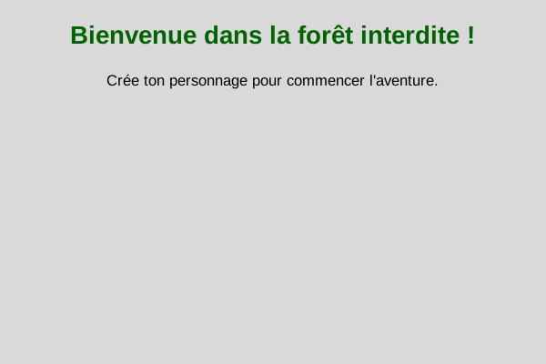

**Résultat attendu :** Le titre en vert et en gras en haut de la fenêtre, la consigne en dessous.

À surveiller : Créer un Label ne suffit pas : sans pack(), il n’apparaît pas. Un widget est un élément de l’interface : étiquette, bouton, zone de saisie…

### 3. Une couleur de fond

configure(bg=...) change la couleur de fond (background) de la fenêtre. Une couleur s’écrit par son nom anglais ("white", "darkgreen") ou par son code hexadécimal ("#1f3d2b"). Ranger la couleur dans une constante FOND évite de la recopier partout et permet de la changer en une seule ligne.

```python
import tkinter as tk

FOND = "#1f3d2b"

fenetre = tk.Tk()
fenetre.title("La forêt interdite")
fenetre.geometry("600x400")
fenetre.configure(bg=FOND)

titre = tk.Label(fenetre, text="Bienvenue dans la forêt interdite !",
                 font=("Arial", 20, "bold"), fg="white", bg=FOND)
titre.pack(pady=20)

consigne = tk.Label(fenetre, text="Crée ton personnage pour commencer l'aventure.",
                    font=("Arial", 12), fg="lightgreen", bg=FOND)
consigne.pack()

fenetre.mainloop()
```

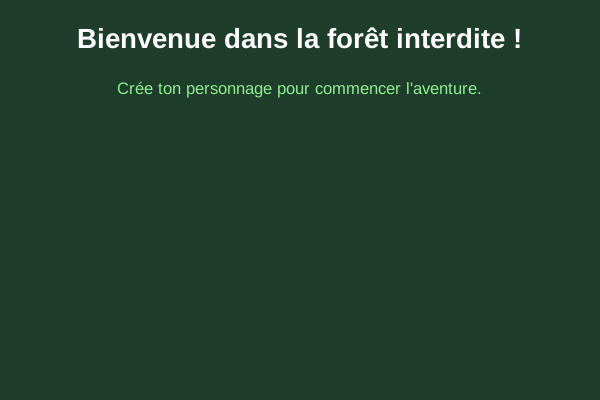

**Résultat attendu :** Une fenêtre vert forêt, avec le titre en blanc et la consigne en vert clair.

À surveiller : Chaque Label a son propre fond, gris par défaut. Donne-lui aussi bg=FOND, sinon il apparaît comme un rectangle gris sur le fond vert.

### 4. Une image de fond

tk.PhotoImage lit une image PNG ou GIF. On l’affiche dans un Label, placé avec place(x=0, y=0, relwidth=1, relheight=1) : il occupe toute la fenêtre. Les widgets créés ensuite s’affichent par-dessus. L’image fournie fond_foret.png mesure 800 × 500 pixels, comme la fenêtre.

```python
import tkinter as tk

FOND = "#1f3d2b"

fenetre = tk.Tk()
fenetre.title("La forêt interdite")
fenetre.geometry("800x500")

fond = tk.PhotoImage(file="fond_foret.png")
image_fond = tk.Label(fenetre, image=fond)
image_fond.place(x=0, y=0, relwidth=1, relheight=1)

titre = tk.Label(fenetre, text="Bienvenue dans la forêt interdite !",
                 font=("Arial", 22, "bold"), fg="white", bg=FOND)
titre.pack(pady=20)

fenetre.mainloop()
```

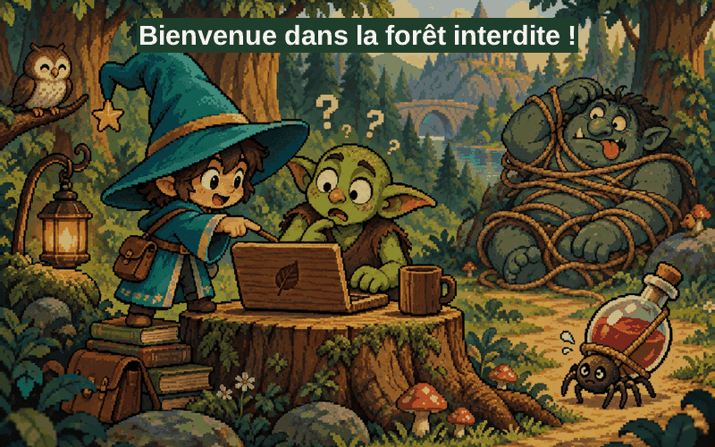

**Résultat attendu :** L’illustration de la forêt remplit la fenêtre ; le titre s’affiche par-dessus, sur un bandeau vert.

À surveiller : Le fichier image doit être dans le même dossier que ton programme, sinon tu obtiens l’erreur « couldn't open "fond_foret.png" ». Garde l’image dans une variable (fond) : si elle disparaît, l’image ne s’affiche plus. Les fichiers JPG ne sont pas acceptés par PhotoImage.

### 5. Une zone de saisie et un bouton : le nom

Entry est une zone de saisie d’une ligne ; get() renvoie le texte tapé, comme input(). Un Button exécute la fonction donnée dans command à chaque clic. config(text=...) modifie un Label déjà affiché : c’est ainsi qu’on écrit un message dans la fenêtre.

```python
import tkinter as tk

def valider_nom():
    nom = saisie_nom.get()
    if nom == "":
        message.config(text="Entre un nom.", fg="firebrick")
    else:
        message.config(text="Bienvenue, " + nom + " !", fg="darkgreen")

fenetre = tk.Tk()
fenetre.title("La forêt interdite")
fenetre.geometry("600x400")

tk.Label(fenetre, text="Nom du personnage :", font=("Arial", 12)).pack(pady=10)
saisie_nom = tk.Entry(fenetre, width=25)
saisie_nom.pack()
tk.Button(fenetre, text="Valider", command=valider_nom).pack(pady=10)
message = tk.Label(fenetre, text="", font=("Arial", 12))
message.pack()

fenetre.mainloop()
```

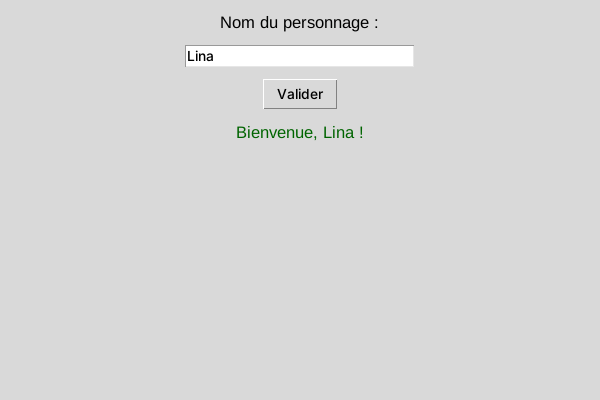

**Résultat attendu :** Après avoir tapé Lina et cliqué sur Valider : « Bienvenue, Lina ! » en vert. Sans nom : « Entre un nom. » en rouge.

À surveiller : Écris command=valider_nom sans parenthèses : on donne la fonction au bouton, qui l’appellera au clic. Avec valider_nom(), elle serait appelée une seule fois, au lancement. La fonction est définie avant les widgets qu’elle utilise : ce n’est pas un problème, car elle ne s’exécute qu’au clic, quand ils existent.

### 6. Choisir la classe avec des boutons radio

Des boutons radio permettent de choisir une seule option parmi plusieurs. Ils partagent une variable Tkinter : tk.StringVar(value="guerrier") crée cette variable et choisit la valeur de départ. Chaque bouton indique la valeur qu’il donne à la variable (value=classe). get() lit le choix. La boucle for crée les trois boutons sans recopier trois fois la même ligne.

```python
import tkinter as tk

def afficher_classe():
    message.config(text="Classe choisie : " + classe_choisie.get())

fenetre = tk.Tk()
fenetre.title("La forêt interdite")
fenetre.geometry("600x400")

tk.Label(fenetre, text="Choisis ta classe :", font=("Arial", 12)).pack(pady=10)
classe_choisie = tk.StringVar(value="guerrier")
for classe in ["guerrier", "mage", "archer"]:
    tk.Radiobutton(fenetre, text=classe, value=classe, variable=classe_choisie).pack()

tk.Button(fenetre, text="Valider", command=afficher_classe).pack(pady=10)
message = tk.Label(fenetre, text="", font=("Arial", 12))
message.pack()

fenetre.mainloop()
```

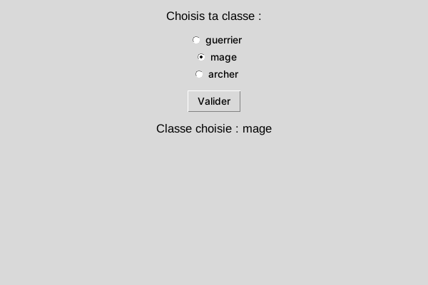

**Résultat attendu :** Trois boutons guerrier, mage, archer ; un seul peut être coché. Valider affiche « Classe choisie : mage ».

À surveiller : Tous les boutons doivent partager la même variable, sinon plusieurs peuvent être cochés en même temps. Avec des boutons radio, une classe inconnue comme « dragon » devient impossible : l’interface empêche certaines erreurs de saisie.

### 7. Les compétences : Spinbox et rangement en grille

Un Spinbox est une zone de nombre avec deux flèches : from_ et to fixent les bornes (0 à 15). state="readonly" empêche de taper au clavier : seules les flèches changent la valeur. command appelle une fonction à chaque clic sur une flèche : ici, elle recalcule les points restants. Une Frame est un cadre qui regroupe des widgets ; à l’intérieur, grid(row=..., column=...) les range en lignes et en colonnes, comme un tableau.

```python
import tkinter as tk

def mettre_a_jour_total():
    total = int(choix_force.get()) + int(choix_intel.get()) + int(choix_agilite.get())
    restants.config(text="Points restants : " + str(15 - total))

fenetre = tk.Tk()
fenetre.title("La forêt interdite")
fenetre.geometry("600x400")

formulaire = tk.Frame(fenetre, padx=20, pady=20)
formulaire.pack(pady=20)

tk.Label(formulaire, text="Force :").grid(row=0, column=0, sticky="e")
choix_force = tk.Spinbox(formulaire, from_=0, to=15, width=4, state="readonly",
                         command=mettre_a_jour_total)
choix_force.grid(row=0, column=1, pady=3)

tk.Label(formulaire, text="Intelligence :").grid(row=1, column=0, sticky="e")
choix_intel = tk.Spinbox(formulaire, from_=0, to=15, width=4, state="readonly",
                         command=mettre_a_jour_total)
choix_intel.grid(row=1, column=1, pady=3)

tk.Label(formulaire, text="Agilité :").grid(row=2, column=0, sticky="e")
choix_agilite = tk.Spinbox(formulaire, from_=0, to=15, width=4, state="readonly",
                           command=mettre_a_jour_total)
choix_agilite.grid(row=2, column=1, pady=3)

restants = tk.Label(formulaire, text="Points restants : 15", font=("Arial", 11, "bold"))
restants.grid(row=3, column=0, columnspan=2, pady=10)

fenetre.mainloop()
```

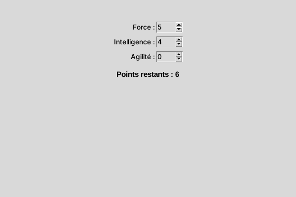

**Résultat attendu :** Un formulaire aligné. Avec force 5 et intelligence 4 : « Points restants : 6 ».

À surveiller : get() renvoie du texte, même pour un Spinbox : il faut int() avant de calculer. Dans un même cadre, utilise soit pack, soit grid, jamais les deux : Tkinter se bloquerait. Ici, la Frame est placée avec pack dans la fenêtre, et ses widgets avec grid dans la Frame.

### 8. Valider le personnage et le ranger dans un dictionnaire

Au clic sur « Créer mon personnage », la fonction lit les valeurs, reprend les contrôles du TP1 puis range le personnage dans le dictionnaire hero (partie 6) et calcule l’attaque et la défense du TP5. Une fonction peut modifier le contenu d’un dictionnaire créé en dehors d’elle : hero["nom"] = nom le remplit, et les autres fonctions pourront le lire plus tard.

```python
import tkinter as tk

hero = {}

def creer_personnage():
    nom = saisie_nom.get()
    force = int(choix_force.get())
    intelligence = int(choix_intel.get())
    agilite = int(choix_agilite.get())
    total = force + intelligence + agilite
    if nom == "":
        message.config(text="Entre un nom.", fg="firebrick")
    elif total != 15:
        texte = "La somme doit valoir 15 (actuellement " + str(total) + ")."
        message.config(text=texte, fg="firebrick")
    else:
        hero["nom"] = nom
        hero["force"] = force
        hero["intelligence"] = intelligence
        hero["agilite"] = agilite
        hero["attaque"] = 7 + force
        hero["defense"] = 4 + agilite
        texte = nom + " est prêt : attaque " + str(hero["attaque"])
        texte = texte + ", défense " + str(hero["defense"]) + "."
        message.config(text=texte, fg="darkgreen")

fenetre = tk.Tk()
fenetre.title("La forêt interdite")
fenetre.geometry("600x400")

tk.Label(fenetre, text="Nom :").pack()
saisie_nom = tk.Entry(fenetre)
saisie_nom.pack()
tk.Label(fenetre, text="Force, intelligence, agilité :").pack(pady=5)
choix_force = tk.Spinbox(fenetre, from_=0, to=15, width=4, state="readonly")
choix_force.pack()
choix_intel = tk.Spinbox(fenetre, from_=0, to=15, width=4, state="readonly")
choix_intel.pack()
choix_agilite = tk.Spinbox(fenetre, from_=0, to=15, width=4, state="readonly")
choix_agilite.pack()
tk.Button(fenetre, text="Créer mon personnage", command=creer_personnage).pack(pady=10)
message = tk.Label(fenetre, text="")
message.pack()

fenetre.mainloop()
```

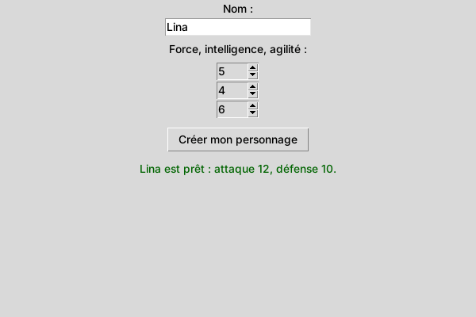

**Résultat attendu :** Lina, 5 / 4 / 6 : « Lina est prêt : attaque 12, défense 10. » Avec 5 / 5 / 6 : « La somme doit valoir 15 (actuellement 16). »

À surveiller : Écrire nom = ... dans la fonction crée une variable qui disparaît à la fin de l’appel. Pour conserver le personnage, range-le dans le dictionnaire hero. Les Spinbox commencent à 0 : les compétences négatives sont impossibles, il reste à contrôler la somme.

### 9. Passer de la création au combat : deux écrans

Chaque écran est une Frame. On crée les deux au lancement, mais on n’affiche (pack) que le premier. Pour changer d’écran, pack_forget() cache la Frame affichée, puis pack() montre l’autre. Les widgets de l’écran caché ne sont pas détruits : on pourra les réutiliser.

```python
import tkinter as tk

def lancer_aventure():
    ecran_creation.pack_forget()
    ecran_combat.pack(pady=40)

fenetre = tk.Tk()
fenetre.title("La forêt interdite")
fenetre.geometry("600x400")

ecran_creation = tk.Frame(fenetre, bg="#f4efe1", padx=30, pady=30)
ecran_creation.pack(pady=40)
tk.Label(ecran_creation, text="Écran 1 : création du personnage", bg="#f4efe1").pack()
tk.Button(ecran_creation, text="Entrer dans la forêt", command=lancer_aventure).pack(pady=10)

ecran_combat = tk.Frame(fenetre, bg="#fbe0e6", padx=30, pady=30)
tk.Label(ecran_combat, text="Écran 2 : le combat commence !", bg="#fbe0e6").pack()

fenetre.mainloop()
```

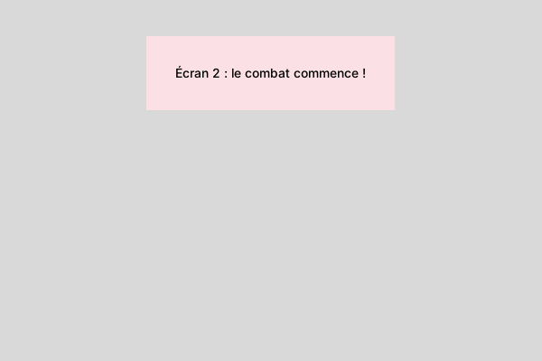

**Résultat attendu :** Au clic sur « Entrer dans la forêt », le cadre de création disparaît et le cadre rose du combat apparaît.

À surveiller : Un widget doit être créé dans sa Frame (tk.Label(ecran_combat, ...)) et non dans fenetre, sinon il reste affiché quand on change d’écran.

### 10. Afficher les PV : textes, barres de vie et journal

Un Canvas est une zone de dessin. create_rectangle(x1, y1, x2, y2, fill=...) y dessine un rectangle et renvoie son numéro ; coords(rectangle, ...) change ensuite ses coordonnées. La barre fait 200 pixels de large à PV pleins : pour 70 PV sur 100, elle mesure 200 × 70 / 100 = 140 pixels. Un widget Text affiche plusieurs lignes : insert("end", ...) ajoute du texte à la fin, see("end") fait défiler jusqu’à la dernière ligne.

```python
import tkinter as tk

def ecrire(texte):
    journal.insert("end", texte + "\n")
    journal.see("end")

def dessiner_barre(canevas, rectangle, pv, pv_max):
    largeur = int(200 * pv / pv_max)
    canevas.coords(rectangle, 0, 0, largeur, 18)

fenetre = tk.Tk()
fenetre.title("La forêt interdite")
fenetre.geometry("600x400")

infos_hero = tk.Label(fenetre, text="Lina : 70 PV", font=("Arial", 12, "bold"))
infos_hero.pack(pady=10)

barre_hero = tk.Canvas(fenetre, width=200, height=18, bg="white")
barre_hero.pack()
rect_hero = barre_hero.create_rectangle(0, 0, 200, 18, fill="seagreen", width=0)
dessiner_barre(barre_hero, rect_hero, 70, 100)

journal = tk.Text(fenetre, width=50, height=8)
journal.pack(pady=15)
ecrire("Attention : le gobelin surgit des fourrés !")
ecrire("Riposte : le gobelin te frappe, -20 PV.")

fenetre.mainloop()
```

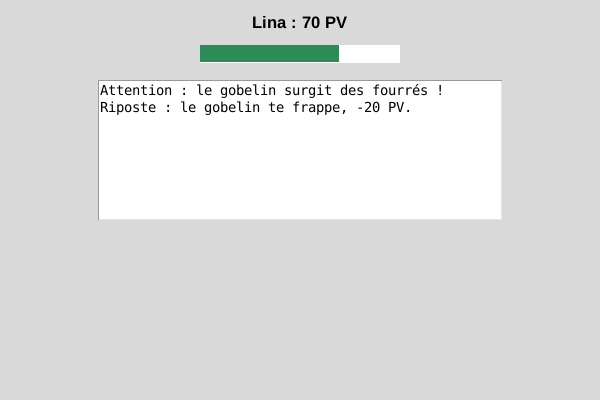

**Résultat attendu :** « Lina : 70 PV », une barre verte remplie aux 7/10, et un journal de deux lignes.

À surveiller : Après chaque tour, il faut mettre à jour tous les affichages (textes et barres) : les widgets ne se recalculent pas tout seuls quand une variable change. Regroupe ces mises à jour dans une fonction afficher_etat().

### 11. Un clic = un tour de combat

La fonction du bouton Attaquer joue exactement un tour : attaque du héros, riposte si le monstre vit encore, puis mise à jour de l’affichage. L’état du combat (les PV) est rangé dans le dictionnaire jeu pour être conservé d’un clic à l’autre. config(state="disabled") grise un bouton quand le combat est fini.

```python
import tkinter as tk
import random

def lancer_de(nb_faces):
    return random.randint(1, nb_faces)

def appliquer_degats(pv, degats):
    reste = pv - degats
    if reste < 0:
        return 0
    return reste

def est_attaque_passee(de_attaque, attaque, de_defense, defense):
    return de_attaque <= attaque and de_defense > defense

hero = {"nom": "Lina", "attaque": 12, "defense": 10}
jeu = {"pv_hero": 100, "pv_monstre": 40}

def afficher_etat():
    texte = hero["nom"] + " : " + str(jeu["pv_hero"]) + " PV"
    texte = texte + "   |   gobelin : " + str(jeu["pv_monstre"]) + " PV"
    infos.config(text=texte)

def clic_attaquer():
    de_attaque = lancer_de(20)
    de_defense = lancer_de(20)
    if est_attaque_passee(de_attaque, hero["attaque"], de_defense, 7):
        jeu["pv_monstre"] = appliquer_degats(jeu["pv_monstre"], 20)
        message.config(text="Tu touches le gobelin : -20 PV.")
    else:
        message.config(text="Ton attaque échoue.")
    if jeu["pv_monstre"] > 0:
        if est_attaque_passee(lancer_de(20), 9, lancer_de(20), hero["defense"]):
            jeu["pv_hero"] = appliquer_degats(jeu["pv_hero"], 20)
    else:
        message.config(text="Le gobelin est vaincu !")
        bouton_attaquer.config(state="disabled")
    afficher_etat()

fenetre = tk.Tk()
fenetre.title("La forêt interdite")
fenetre.geometry("600x400")

infos = tk.Label(fenetre, text="", font=("Arial", 13, "bold"))
infos.pack(pady=30)
message = tk.Label(fenetre, text="Un gobelin te barre la route.")
message.pack()
bouton_attaquer = tk.Button(fenetre, text="Attaquer", command=clic_attaquer)
bouton_attaquer.pack(pady=20)
afficher_etat()

fenetre.mainloop()
```

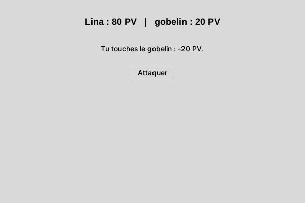

**Résultat attendu :** Chaque clic affiche le résultat du tour. Quand le gobelin tombe à 0 PV : « Le gobelin est vaincu ! » et le bouton est grisé.

À surveiller : N’écris pas de boucle while dans la fonction d’un bouton : la fenêtre resterait figée jusqu’à la fin de la boucle et le joueur ne pourrait plus cliquer. Un bouton ne peut pas passer d’argument à command : pour attaquer et boire une potion, écris deux fonctions clic_attaquer() et clic_potion(), qui peuvent appeler une même fonction jouer_tour(action).

### 12. Enchaîner les combats et finir la partie

La liste jeu["monstres"] contient les adversaires restants. nouveau_combat() en choisit un avec random.choice et lui redonne ses PV. Quand un monstre est vaincu, on le retire de la liste ; si elle est vide, c’est la victoire, sinon on lance le combat suivant. nouvelle_partie() remet tout à zéro : c’est elle que le bouton Rejouer appelle.

```python
import tkinter as tk
import random

jeu = {"monstres": [], "monstre": "", "pv_monstre": 0}

def nouvelle_partie():
    jeu["monstres"] = ["le gobelin", "l'araignée", "le troll"]
    bouton_attaquer.config(state="normal")
    nouveau_combat()

def nouveau_combat():
    jeu["monstre"] = random.choice(jeu["monstres"])
    jeu["pv_monstre"] = 40
    message.config(text="Attention : " + jeu["monstre"] + " surgit !")

def clic_attaquer():
    jeu["pv_monstre"] = jeu["pv_monstre"] - 20
    if jeu["pv_monstre"] > 0:
        message.config(text=jeu["monstre"] + " : " + str(jeu["pv_monstre"]) + " PV")
    else:
        jeu["monstres"].remove(jeu["monstre"])
        if len(jeu["monstres"]) == 0:
            message.config(text="Victoire ! La forêt est libérée.")
            bouton_attaquer.config(state="disabled")
        else:
            nouveau_combat()

fenetre = tk.Tk()
fenetre.title("La forêt interdite")
fenetre.geometry("600x400")

message = tk.Label(fenetre, text="", font=("Arial", 13))
message.pack(pady=40)
bouton_attaquer = tk.Button(fenetre, text="Attaquer", command=clic_attaquer)
bouton_attaquer.pack()
tk.Button(fenetre, text="Rejouer", command=nouvelle_partie).pack(pady=10)
nouvelle_partie()

fenetre.mainloop()
```

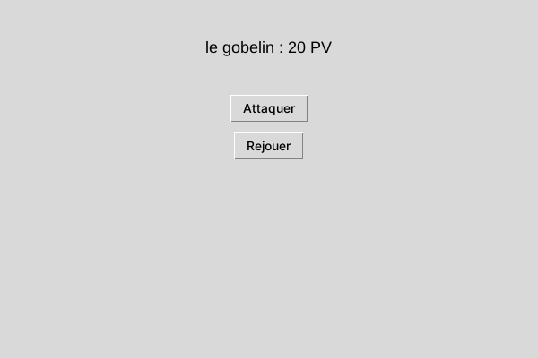

**Résultat attendu :** Après deux attaques, le premier monstre disparaît et le suivant surgit ; après les trois monstres, « Victoire ! » et le bouton Attaquer est grisé. Rejouer relance une partie.

À surveiller : Ne recrée pas la liste des monstres dans nouveau_combat() : les monstres vaincus reviendraient. Pense à réactiver les boutons (state="normal") quand on rejoue.

### Mission

Un fichier NOM_Prenom_rpg_interface.py qui se lance seul sur ordinateur : un écran d’accueil avec un fond, un formulaire de création qui vérifie le personnage et le range dans hero, puis un écran de combat qui enchaîne les trois monstres du TP5 (un clic = un tour), avec les PV affichés en texte et en barres, un journal, et une fin de partie claire.

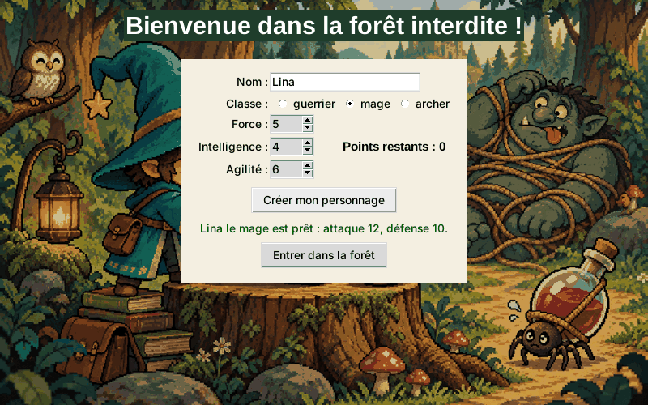

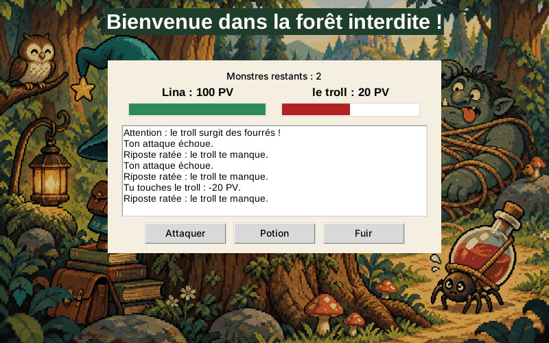

1. Fenêtre d’accueil. Crée une fenêtre de 800 × 500 intitulée « La forêt interdite », avec un fond (couleur ou image fond_foret.png) et un titre de bienvenue lisible sur ce fond.

**Indice 1** — Reprends les notions 1 à 4 : fenêtre, titre, couleur ou image.

**Indice 2** — Si tu utilises l’image, crée le Label de fond en premier : les widgets créés après s’affichent par-dessus. Donne un bg au titre pour qu’il reste lisible.

2. Formulaire de création. Dans une Frame ecran_creation rangée en grille : une zone de saisie pour le nom, trois boutons radio pour la classe (guerrier, mage, archer), trois Spinbox de 0 à 15 pour force, intelligence et agilite, et un texte « Points restants » mis à jour à chaque clic sur une flèche.

**Indice 1** — Range chaque ligne du formulaire dans une ligne de la grille : le texte en colonne 0, le widget en colonne 1.

**Indice 2** — La même fonction mettre_a_jour_total sert aux trois Spinbox : elle relit les trois valeurs à chaque appel.

```python
def mettre_a_jour_total():
    total = int(choix_force.get()) + ___ + ___
    restants.config(text="Points restants : " + str(___))
```

3. Valider le personnage. Le bouton « Créer mon personnage » vérifie qu’un nom est saisi et que la somme vaut 15, et affiche un message d’erreur précis sinon. Si tout est correct, il remplit le dictionnaire hero (nom, classe, force, intelligence, agilite, attaque = 7 + force, defense = 4 + agilite), affiche un récapitulatif et active le bouton « Entrer dans la forêt », grisé au départ.

**Indice 1** — Reprends l’ordre des contrôles du TP1, avec if / elif / else.

**Indice 2** — Le bouton « Entrer dans la forêt » est créé avec state="disabled" ; creer_personnage le rend cliquable avec config(state="normal") quand le personnage est valide.

4. Écran de combat. « Entrer dans la forêt » cache le formulaire et affiche une Frame ecran_combat avec : le nombre de monstres restants, les PV du héros et du monstre en texte et en barres de vie (Canvas), un journal (Text) et trois boutons Attaquer, Potion et Fuir.

**Indice 1** — Crée tout l’écran de combat dès le lancement, mais sans faire pack sur ecran_combat.

**Indice 2** — Pour chaque barre : un Canvas de 200 × 18, un rectangle créé une fois, puis dessiner_barre qui change ses coordonnées. Le maximum vaut 100 pour le héros et 40 pour un monstre.

5. Un tour par clic. Range l’état dans un dictionnaire jeu (PV du héros et du monstre, monstre actuel, liste des monstres). Attaquer et Potion jouent un tour avec les règles du TP5 : deux dés à 20 faces, est_attaque_passee, 20 dégâts, potion de 10 à 20 PV plafonnée à 100, riposte du monstre (attaque 9 contre la défense du héros) s’il est encore vivant. Chaque tour écrit une ligne dans le journal, puis met à jour tous les affichages.

**Indice 1** — Écris d’abord jouer_tour("attaquer") seul, testé avec un seul monstre, puis ajoute la potion et la riposte.

**Indice 2** — Deux petites fonctions relient les boutons à jouer_tour.

```python
def clic_attaquer():
    jouer_tour("attaquer")

def clic_potion():
    jouer_tour(___)
```

6. Trois combats et la fin. Commence avec ["le gobelin", "l'araignée", "le troll"], 100 PV pour le héros et 40 PV par monstre. Un monstre vaincu est retiré de la liste et le suivant surgit, le héros garde ses PV. À la victoire, à la défaite ou à la fuite : un message final dans le journal, les trois boutons grisés et un bouton Rejouer qui relance une partie avec le même personnage.

**Indice 1** — Après chaque tour, une fonction verifier_fin choisit entre défaite, victoire, combat suivant ou rien.

**Indice 2** — Le bouton Rejouer est créé au lancement mais affiché seulement à la fin (pack), puis caché à nouveau (pack_forget) dans nouvelle_partie.

7. Tester et rendre. Vérifie les tests ci-dessous, en fixant temporairement les dés si besoin (par exemple, remplace de_attaque = lancer_de(20) par de_attaque = 1 et de_defense = lancer_de(20) par de_defense = 20 : l’attaque du héros passe toujours). Écris en commentaires en haut du fichier deux tests attendu / observé et les aides utilisées, puis rends ton fichier.

**Indice 1** — Un dé fixé rend chaque tour prévisible.

**Indice 2** — Pour tester la défaite vite, mets temporairement jeu["pv_hero"] = 20 au début de la partie ; pour la victoire, des monstres à 20 PV.

### Tests

- Sans nom → « Entre un nom. » ; Lina 5 / 5 / 6 → message d’erreur avec la somme 16 ; le bouton « Entrer dans la forêt » reste grisé.
- Lina, mage, 5 / 4 / 6 → « Points restants : 0 », attaque 12, défense 10, bouton « Entrer dans la forêt » actif.
- Écran de combat : 3 monstres restants, 100 PV et barre verte pleine pour le héros, 40 PV et barre rouge pleine pour le monstre.
- Attaque qui passe (de_attaque fixé à 1, de_defense fixé à 20) → monstre à 20 PV, barre à moitié, une ligne dans le journal.
- Potion à 95 PV avec un gain de 20 → 100 PV, pas plus.
- Dernier monstre vaincu → « Victoire » dans le journal, boutons grisés, bouton Rejouer visible ; Rejouer → 100 PV, 3 monstres, boutons actifs. Fuir → message de fuite et boutons grisés.

### Critères de réussite · repères sur 5

- Fenêtre d’accueil avec fond et texte lisible : 1 point(s)
- Formulaire complet (nom, classe, 3 compétences, points restants) : 1 point(s)
- Validation du personnage et dictionnaire hero rempli : 1 point(s)
- Écran de combat : un clic = un tour, affichages mis à jour, règles du TP5 : 1 point(s)
- Enchaînement des trois combats, fin de partie et Rejouer, tests commentés : 1 point(s)

### Pour aller plus loin

- Une image par monstre : un dictionnaire images = {"le gobelin": tk.PhotoImage(file="gobelin.png"), ...} et un Label dont on change l’image avec config(image=...).
- Limiter les potions au nombre de points d’intelligence, avec un texte « Potions : 3 » et le bouton Potion grisé quand il n’en reste plus.
- Afficher l’image de la classe choisie (guerrier, mage, archer) dans le récapitulatif du personnage.
- Faire clignoter la barre du monstre touché : fenetre.after(300, fonction) appelle une fonction 300 millisecondes plus tard, sans bloquer la fenêtre.
